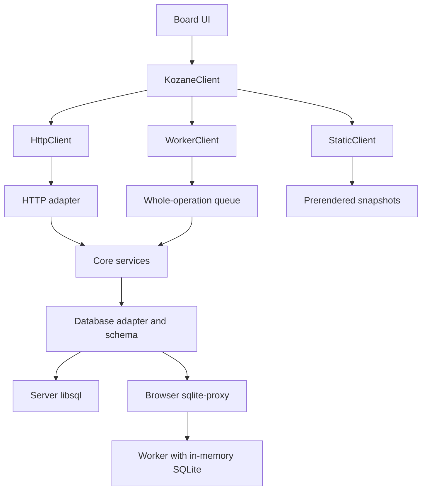

# Web demo specification

## Overview

Kozane's shared UI uses the `KozaneClient` interface. That makes the server one interchangeable backend, so a browser-only web demo can run the real UI and business rules without a backend server. Edits stay in memory, with best-effort reload recovery through sessionStorage.

### Background

The static export is read-only, and editing uses `kozane open` with a Node server and a SQLite database. The shared UI accepts an injected client, while HTTP handlers receive their database through the Node host. The browser demo adds editing through public core and client packages.

### Goals

1. Views depend only on `KozaneClient`, never on `fetch` or route paths directly.
2. Business rules (validation, clamping, transactions) live in one transport-free service layer, shared by HTTP routes, the CLI and the in-browser backend.
3. A public web demo lets anyone create, edit and arrange cards in the browser. Editing and internal navigation send no user content to a server. Deliberately opening a link from card content follows the exception under data lifetime and privacy. Reload recovery uses sessionStorage, with no application-managed persistent user storage.
4. The demo lives in its own repository and depends on versioned npm packages, not on Kozane's source tree.
5. `npm install --global kozane` and existing workspaces keep working unchanged throughout.

### Non-goals

- User accounts, login or multi-user sync in the demo.
- Persistent user storage such as IndexedDB, OPFS or localStorage in the first release. Browser session restoration remains outside the app’s control.
- Taskspaces and other filesystem features in the browser.
- A public, stable HTTP API for third parties. The HTTP routes stay internal to `kozane`.

## Existing packages

The repository contains core, client and the unscoped CLI package. The current release candidates are core 0.1.0, client 0.1.0 and kozane 0.22.0. Publish and verify them through the [local release flow](releases.md) before creating the separate demo repository.

| Area              | Existing implementation                                                | Demo requirement                                                   |
| ----------------- | ---------------------------------------------------------------------- | ------------------------------------------------------------------ |
| Shared UI         | Client views receive backend, navigation and preference adapters       | Supply one browser-root local backend                              |
| Domain rules      | Core owns schema, records, services, validation and transactions       | Use public services through the worker queue                       |
| HTTP and CLI      | Node adapters retain transport, filesystem and workspace policy        | Keep Node-only features out of the demo                            |
| Database adapters | Core exposes generic async SQLite handles and transaction hooks        | Implement hooks for worker-backed SQLite wasm                      |
| Migrations        | Public ordered SQL, history validation and canonical schema APIs       | Generate and validate sample/recovery bytes through public exports |
| Static export     | StaticClient serves embedded read-only data                            | Prerender the preview and attach the local backend after hydration |
| Package checks    | Isolated consumers, runtime identity and retained compatibility corpus | Exercise the same corpus through the production restoration path   |

## Target architecture

The board UI calls one `KozaneClient` interface. Both the server and the browser demo run the same `@kozane/core` services, so business rules exist in exactly one place.



HTTP and worker clients reach the same services through different transports. The static client reads prerendered data and rejects writes.

| Layer                  | Responsibility                                                 | Must not                                         |
| ---------------------- | -------------------------------------------------------------- | ------------------------------------------------ |
| Board UI               | Render, gestures, editing; choose features from `capabilities` | Call `fetch`, build API URLs, check `KOZANE_SSG` |
| `KozaneClient`         | Typed contract between UI and data                             | Expose HTTP details (statuses, headers, URLs)    |
| Client implementations | Move calls to where data lives                                 | Contain business rules                           |
| HTTP adapter           | Parse requests, call services, map errors to statuses          | Query the database or validate fields itself     |
| Services               | Validation, rules, transactions                                | Import `node:`, SvelteKit, or read `process.env` |
| `db/api` + schema      | Queries and table definitions                                  | Know about requests or users                     |

## Service layer

All database-backed domain rules move from routes, page loaders and CLI commands into `@kozane/core/services`. CLI adapters retain argument parsing, resource-reference resolution and output formatting, and delegate shared validation, rules and transaction ownership to services. A service is a plain async function `(db, context, ...resourceIds, input) => result`. It has no knowledge of HTTP, SvelteKit, `process.env` or the filesystem.

### Rules

1. Signature: `service(db: DB, context: ServiceContext, ...args): Promise<Result>`. Resource-specific arguments include identifiers and untrusted input that the service validates. Services open their own transaction with `withTx` when they need one. Operations that need adapter-specific reference resolution also expose a transaction-bound variant accepting `Tx`. A public core composition helper owns the write transaction and invokes an adapter callback with that `Tx`. The callback resolves references and calls the transaction-bound service variant using the same handle. Transaction-bound variants perform the same validation and rules without opening a nested transaction. CLI adapters use this helper wherever reference resolution currently shares a transaction with the mutation, including card creation. Reference parsing and resolution remain in the CLI, while core owns commit and rollback. Resolution failure rolls back the entire operation.
2. Validation: input validation (today's `requireString`, `requireFiniteNumber`, `requireObjectArray`, batch caps, content limits) runs inside the service, so every backend enforces it identically. Parsing JSON from a request body stays in the HTTP adapter.
3. Errors: services throw domain errors only: `ValidationError`, `NotFoundError`, `ConflictError`, `DefaultPartitionError`, `DefaultLayerError`, `LimitError`, `UnavailableError`. They never call SvelteKit's `error()`.
4. Results: services return the same typed shapes the client already reads (`CardWithGlue`, `Inventory`, `ScopeArea`, `Warp`, snapshot types). Types are exported from `@kozane/core`.
5. Configuration: values that come from config or environment today are passed in through `ServiceContext`, never read from `process.env`. Core exports `createServiceContext(overrides?)` through `./database`. It returns an immutable context with `contentMax` defaulting to the existing `CONTENT_MAX` of 200,000 characters. Overrides follow the existing workspace configuration validation rules. Batch caps and name limits remain shared core constants. Node adapters resolve workspace configuration and pass its `contentMax` to the factory. The demo and sample builder use factory defaults. Any additional configurable service field must declare its type, default and override validation in this public contract before extraction. Client parity requires equivalent contexts. The contract suite covers defaults and matching non-default content limits, including identical boundary errors. HTTP body limits remain transport concerns and must accommodate content accepted by the configured services.
6. Purity: no `node:` imports. A lint rule (oxlint `no-restricted-imports`) enforces this for `packages/core`.

### Database type

`DB`, `Tx` and `ReadTx` widen from `LibSQLDatabase` to Drizzle's async SQLite base type (`BaseSQLiteDatabase<"async", unknown, typeof schema>`), keeping the phantom brands in `tx.ts`. The server passes a libsql handle and the browser passes a `sqlite-proxy` handle; services and `db/api` cannot tell them apart. The public `@kozane/core/database` entry point exports branded database types, `ServiceContext`, transaction helpers and `createDatabaseAdapter`. The factory accepts an unbranded Drizzle handle and driver hooks for read and write transactions, and returns a branded `DB`. Branding casts stay inside core. Services use `withTx` and `withReadTx` through these hooks.

The Node implementation lives in `kozane` and preserves current libsql write and deferred-read behavior. The demo supplies sqlite-proxy hooks, including explicit transaction behavior and foreign-key initialization. Libsql-only operations go through transport-free adapter operations with one implementation per driver. Core never imports a Node driver. Consumers must be able to initialize a database, apply migrations and call services through public exports alone.

### Error normalization

Database adapters classify driver failures through a transport-free hook. Core converts unique-constraint failures to `ConflictError`, foreign-key failures to `NotFoundError`, and unclassified database failures to `UnavailableError`. Services preserve existing resource-specific messages. Normalize failures after transaction rollback, including failures during commit. If rollback fails or the adapter cannot establish a usable transaction state, invalidate the connection and report `UnavailableError`. Preserve the original failure and rollback failure as diagnostic causes. Never return the connection to normal use until the adapter has reopened it successfully. Already classified domain errors pass through unchanged. Unexpected failures retain their cause for diagnostics without exposing SQL or parameters to the UI.

Core exports a transport-free `DatabaseFailureKind` through `./database` with values `database_content`, `transient` and `unknown`. The driver classification hook supplies this metadata separately from the domain error code. Recognized corruption or invalid-database driver codes and explicit integrity, foreign-key consistency, migration-history and required-schema validation failures establish `database_content`. Lock contention and temporary driver availability failures are `transient`. Unrecognized failures default to `unknown`. A rejected mutation's foreign-key constraint does not establish corrupt stored data. A missing namespace establishes a sample defect only when sample validation requires that namespace. Never infer a content defect from a message string, `not_found` or `unavailable` alone.

Preserve this classification through core error normalization and the internal worker RPC error envelope. Validate the envelope's allowlisted classification and default missing or invalid metadata to `unknown`. Core validation helpers return typed defect reasons so the demo does not inspect SQL, driver messages or diagnostic causes. Connection failures, timeouts, decoding errors and failed rollback do not establish a database-content defect. If connection failure prevents completing validation, preserve the saved copy and follow connection recovery. The demo root uses the classification and candidate source to choose the existing recovery policy. Confirmed content defects in a restored copy permit validated sample fallback. Confirmed defects in sample bytes require reload. Transient and unknown failures preserve the copy and offer retry unless a separate build-asset failure requires reload. Keep this metadata internal to database and recovery adapters. It does not add a UI backend code or change HTTP response bodies or headers. Safe UI messages remain separate from diagnostic causes.

Both backends use the same domain-error-to-code mapping. Validation and default-layer or default-partition errors map to `validation`, missing records to `not_found`, conflicts to `conflict`, limits to `limit`, and unavailable errors to `unavailable`. The default HTTP statuses are 400, 404, 409, 413 and 500 respectively. Existing endpoints retain their current statuses, response bodies and resource-specific wording through explicit operation-specific compatibility mappings in the HTTP adapter. For example, duplicate partition and layer names remain HTTP 400 while their backend code is `conflict`. Existing content and batch validation limits that return 400 remain `validation`. Extraction does not reclassify them as `limit`. New limit errors use `limit` and HTTP 413.

For domain errors, the HTTP adapter adds an `X-Kozane-Error-Code` response header containing the backend code without changing the JSON body. `HttpClient` reads an allowlisted code from this header before falling back to the status mapping. Statuses 401, 403 and 429 remain authoritative for authentication, permission and throttling errors. Responses without the header, including those from older servers, use the status fallback and retain their message. Domain-code parity requires the updated server. An older server’s ambiguous 400 response remains `validation`. Transport failures map to `network` in `HttpClient`. Document compatibility mappings by operation and error case, and test them against existing route responses.

### Recovery decision contract

This table defines the recovery action for each failure class. The database classification rules above establish the failure class. [WorkerClient details](#workerclient-details) define queue ordering, generation changes and reset barriers. [Session persistence](#session-persistence) defines validation and storage handling. [Loading strategy](#loading-strategy) defines startup deadlines and cleanup. Acceptance checks and phase gates verify these contracts.

| Failure or outcome                                                                                                          | Required action                                                                             | Saved copy                                                                             |
| --------------------------------------------------------------------------------------------------------------------------- | ------------------------------------------------------------------------------------------- | -------------------------------------------------------------------------------------- |
| Confirmed invalid restored data or incompatible saved schema                                                                | Close the rejected candidate and validate the sample before fallback                        | Attempt deletion only after fallback database and initial view-data validation succeed |
| Confirmed sample database defect                                                                                            | Require explicit reload and prohibit retry or start over against the same assets            | Preserve                                                                               |
| Confirmed missing asset, hash or build-ID mismatch, or wasm compilation failure                                             | Require explicit reload                                                                     | Preserve                                                                               |
| Worker or connection failure, deadline expiry, transient network failure, or unknown initialization or service-read failure | Enter unavailable state and offer explicit retry with a new attempt and generation          | Preserve                                                                               |
| Retryable failure during start over                                                                                         | Retain start-over intent and retry sample initialization through a new reset barrier        | Preserve until reset validation succeeds                                               |
| Storage access, write or deletion failure                                                                                   | Continue in memory and disclose unavailable recovery or an older-copy warning as applicable | Best-effort handling under session persistence                                         |
| Working database exceeds the recovery-copy limit                                                                            | Continue editing in memory and suspend recovery saves for this generation                   | Attempt stale-copy deletion and disclose failure                                       |
| Saved recovery envelope exceeds a decoding limit                                                                            | Stop before the affected parsing or decoding stage and validate the sample before fallback  | Attempt deletion only after fallback database and initial view-data validation succeed |
| Valid empty workspace, namespace selection required, or explicit unknown destination                                        | Show the corresponding view state after successful validation                               | Preserve                                                                               |

Retry never replays rejected mutations. Reload-required asset and sample failures take precedence over retryable failures. Reset uses the build-time sample namespace and must validate it before activation, deletion or navigation. An ordinary failed mutation or missing requested namespace does not establish corrupt stored data.

### Node service boundary

Taskspace file access, authentication, configuration and health checks remain in `kozane`. Node services own filesystem operations and their validation. They call core services for shared database rules. Route adapters may parse transport input and enforce authentication, but delegate domain and filesystem work to the appropriate service.

Maintain an explicit classification of core-backed domain routes and page loaders, Node feature routes, and infrastructure routes. Core-backed handlers delegate database rules to core services. Node feature handlers delegate filesystem rules to Node services. Infrastructure routes are exempt from the core-service requirement.

### HTTP adapter after extraction

```ts
export const POST: RequestHandler = apiHandler(async ({ locals, params, request }) => {
  const input = await readJsonObject(request);
  const card = await cards.create(locals.db, ctx(locals), params.namespaceId, input);
  return json(card, { status: 201 });
});
```

`apiHandler` applies the default domain-error status mapping and the explicit compatibility mappings described above, then emits `X-Kozane-Error-Code` while preserving the existing response body. Default-layer and default-partition errors map to `validation` and HTTP 400. Database-error normalization moves out of today’s `httpErrorFromDb` into core and the driver adapters. Compatibility mappings translate errors only and contain no domain validation or database queries.

### Service modules

One module per resource, matching today's route tree: `cards` (create, update, remove, move, squash, partition, layer, stacking), `glues`, `layers`, `partitions`, `scopes` (incl. members and areas), `warps`, `inventories` (incl. take), `snapshot`, `namespaces`, `tags`, `map`, `warpDirectory`. Tags and map services collect database-backed data without filesystem caches. Node services may enrich results with taskspace data when supported.

## Clients

`HttpClient` and `StaticClient` implement `KozaneClient` today. A future `WorkerClient` will provide the browser demo adapter. Views receive one client at startup.

| Client         | Package                    | Runs where                        | Data                      | Writes                                            | Used by                 |
| -------------- | -------------------------- | --------------------------------- | ------------------------- | ------------------------------------------------- | ----------------------- |
| `HttpClient`   | `@kozane/client`           | Browser, talking to `kozane open` | Workspace SQLite file     | Yes                                               | Normal local use        |
| `WorkerClient` | `@kozane/client` (planned) | Browser only                      | In-memory wasm SQLite     | Yes, kept until the tab closes                    | Web demo                |
| `StaticClient` | `@kozane/client`           | Browser, static hosting           | Prerendered snapshot JSON | No (rejects with `ClientError`, code `read_only`) | `kozane net ssg` export |

### Future worker packages

Keep one `WorkerClient` in `@kozane/client` with an injected message transport. It will implement `KozaneClient` without depending on a particular worker lifecycle. Do not add worker packages until their implementations are needed.

| Package                  | Planned responsibility                                                                            |
| ------------------------ | ------------------------------------------------------------------------------------------------- |
| `@kozane/web-worker`     | Dedicated Web Worker entry, database initialization and request handling through core services    |
| `@kozane/service-worker` | Service Worker entry, database initialization, request handling and restart/reconnection behavior |

Both runtimes should share request IDs, response and error envelopes, and cancellation semantics. Keep the protocol independent of Svelte views. Extract `@kozane/worker-protocol` only if sharing it requires a separate package. Worker runtimes must not depend on UI modules.

Keep lifecycle handling in the host transport. A dedicated worker belongs to its creating document. A Service Worker can stop between events, so it must reopen resources and reconnect clients after restarting. Do not assume that an in-memory database survives a Service Worker restart. The initial demo uses a dedicated worker and retains its existing document, suspension and recovery requirements.

Future focus sharing between the local CLI and Web UI belongs to a separate `FocusClient` contract. The local server coordinates that state and provides reads, writes and subscriptions. A worker may process events, but it does not replace the server connection or require focus tracking to become part of `KozaneClient`.

### Interface contract

Public TypeScript declarations are the authoritative operation contract. Service signatures and their input/result types belong to core. The client contract entry at `packages/client/src/backend/contract.ts` defines the resource APIs referenced by `KozaneClient`. Re-export these declarations through the public package entry points specified below. This specification defines the behavior those declarations must satisfy. Resolve disagreements before releasing the affected packages.

Maintain an operation matrix alongside the contract module. For every method, record resource identifiers, required and optional inputs, omission and null semantics, result type, transaction boundary, capability requirements, invalidated datasets and operation-specific error cases. Include keepalive support where applicable and HTTP compatibility mappings for retained endpoints. Cover read-only methods and Node-only taskspace methods. Use existing route and CLI behavior as the compatibility baseline. Every operation needs a contract-suite case or an explicit adapter-only test classification. Keep declaration and matrix coverage complete. An isolated consumer must type-check representative calls to every resource API through public exports alone.

```ts
export interface KozaneClient {
  readonly kind: "http" | "local" | "static";
  readonly capabilities: ClientCapabilities;
  readonly version: ClientVersion;
  subscribe(listener: (event: ClientInvalidation) => void): () => void;
  readonly state: ClientState;
  subscribeState(listener: (state: ClientState) => void): () => void;
  snapshot(ns: string, opts?: { validator?: string }): Promise<SnapshotResult>;
  namespaces: NamespacesApi; // list, get metadata and create namespaces
  tags: TagsApi; // query tags and display metadata
  map: MapApi; // query workspace map, scope links, tags and activity
  warpDirectory: WarpDirectoryApi; // list cross-namespace warp targets
  cards: CardsApi;
  glues: GluesApi;
  layers: LayersApi;
  partitions: PartitionsApi;
  scopes: ScopesApi;
  warps: WarpsApi;
  inventories: InventoriesApi;
  taskspaces?: TaskspacesApi; // present only when capabilities.taskspaces
}
```

Core exports `SnapshotData` as the existing namespace snapshot payload type. The client exports this conditional-read result contract:

```ts
export type SnapshotResult =
  | { status: "changed"; validator: string; data: SnapshotData }
  | { status: "unchanged"; validator: string };
```

Snapshot validators are opaque backend-issued strings. Callers retain the validator with its namespace and applied snapshot, and pass it only when they still have that snapshot. A read without a validator returns `changed` with the complete current payload. A matching validator returns `unchanged` without a payload. A validator from another namespace, backend instance or reset generation must return `changed`, even when the payload is identical. Unknown or expired validators also return `changed`. Errors, including a missing namespace, throw `ClientError` rather than returning `unchanged`. Compare validators against a consistent snapshot inside the operation's read transaction or serialized queue entry. Every successful reset and worker replacement invalidates all previously issued validators. Callers continue to discard superseded results under the view refresh rules.

`HttpClient` translates this contract to the existing HTTP ETag and 304 behavior internally. It binds public validators to its instance, namespace and generation. Local and static backends implement the same changed/unchanged semantics without HTTP objects. Static validators remain valid for unchanged build-time data within the same backend instance. Validator bookkeeping may be bounded, with eviction producing a full `changed` result.

Export `ClientState` from `@kozane/client` as a discriminated union with `status` values `initializing`, `ready`, `recovering` and `unavailable`. Unavailable state includes a safe `ClientError` and a recovery action of `retry` or `reload`. `subscribeState` immediately delivers the current state, then delivers each transition, and returns an unsubscribe function. Lifecycle notifications are independent of data invalidations and occur even when no view request is pending. Shared views subscribe on browser initialization and unsubscribe on disposal. Keep mutation controls disabled unless the backend is ready and the view's initial data has been applied. HTTP request errors alone do not mark the whole backend unavailable. HTTP and static backends start ready once their adapters are initialized.

`WorkerClient` starts initializing, enters recovering during reset or explicit retry, and becomes ready only after database validation and initial view-data validation succeed. Worker failure, including a failed background recovery export, immediately publishes unavailable state. The demo root handles retry and start-over controls and passes lifecycle state to shared views. These actions never replay rejected mutations. An incompatible or missing build asset requires explicit reload instead of repeated database retries.

Every data method returns typed data or throws a `ClientError` with a `code` (`validation`, `not_found`, `conflict`, `limit`, `read_only`, `unauthenticated`, `forbidden`, `rate_limited`, `unavailable`, `network`) and a message. The UI handles these codes, not HTTP statuses. `HttpClient` reads the domain error-code header and falls back to statuses as described under error normalization. Writes dispatched during navigation may accept `{ keepalive: true }`. `HttpClient` preserves the existing request-size guard and forwards keepalive only when the serialized JSON body is present and at most 60 KiB in UTF-8 bytes. Larger bodies use ordinary fetch without keepalive and retain the same payload and validation behavior. Delivery remains best effort, including when multiple keepalive requests compete for the browser’s aggregate quota. Local write completion means the in-memory transaction committed, not that reload recovery completed.

Backend domain inputs use a shared JSON-compatible value contract. Core exports an input preparation helper through `./services`. Both writable backends call it before dispatch, and services apply it before domain validation for direct callers. It copies inputs without invoking getters or `toJSON`, preserves explicit `null`, and omits object properties whose value is `undefined`. Omission and `null` retain their operation-specific meanings. Reject non-finite numbers, `bigint`, functions, symbols, cyclic values, accessor properties, non-plain objects, and array holes or `undefined` elements with the same `validation` code and message on both backends. Supported values are plain objects, dense arrays, strings, finite numbers, booleans and `null`. Prepare inputs before HTTP serialization or local queue insertion so serialization cannot change their meaning and later caller mutations cannot change a queued operation. Domain validation remains in services. Input preparation failures send no request, run no database operation, publish no invalidation and schedule no recovery save.

`HttpClient` maps 401 to `unauthenticated`, 403 to `forbidden`, and 429 to `rate_limited`, including responses from server hooks. Parse error bodies according to content type and provide safe fallback messages for plain-text or malformed responses. A `rate_limited` error may include `retryAfterMs`, derived from `Retry-After`. The UI offers the existing login flow for `unauthenticated`, displays permission errors for `forbidden`, and respects retry delays for `rate_limited`. Never automatically replay mutations after login or throttling. Preserve existing HTTP responses.

Each `HttpClient` instance maintains one throttle deadline shared by all its API methods and automatic refresh work. On any 429, parse `Retry-After` as nonnegative seconds or an HTTP date. Use a one-second delay when the header is missing, invalid or already expired. Extend the deadline to the later of its current value and the newly calculated deadline. Use a monotonic clock for the remaining wait. Until it expires, new data-method calls reject locally with `rate_limited` and the remaining `retryAfterMs`, without dispatching or retaining the operation. Requests already in flight may settle normally. Change-token polling, snapshot polling, invalidation-triggered reads, filesystem refreshes and focus or visibility refreshes share this deadline. Retain the last successful data and coalesce pending automatic refresh work. Focus, navigation and resubscription cannot shorten the deadline. At expiry, resume one coalesced refresh for each still-active dataset and the workspace change token when visible and subscribed, then resume the normal polling schedule. Hidden documents defer automatic refresh until visible. Disposed views receive no deferred refresh. An automatic read may retry after the deadline, but rejected mutations always require a new user action.

### Demo lifecycle contract

Before Gate 5, export a demo-owned lifecycle interface from the demo backend contract module. The root uses it for recovery controls and indicators. Shared client views continue to depend on `KozaneClient`.

```ts
export type RecoveryStatus =
  | { status: "idle" }
  | { status: "pending" }
  | { status: "saved" }
  | {
      status: "unavailable";
      reason: "storage" | "size_limit" | "connection";
      olderCopyMayRestore: boolean;
    };

export interface DemoClient extends KozaneClient {
  reset(): Promise<void>;
  retry(): Promise<void>;
  readonly recoveryStatus: RecoveryStatus;
  subscribeRecovery(listener: (status: RecoveryStatus) => void): () => void;
  dispose(): void;
}
```

`reset()` inserts its barrier synchronously and resolves after that barrier validates and activates its generation and attempts saved-copy deletion. Resolution does not imply readiness or navigation when a later reset remains pending. Failures reject with `ClientError` and publish the recovery action through `ClientState`. `retry()` is accepted only in unavailable state with recovery action `retry`. It retains restoration or start-over intent, creates a new attempt and generation, and resolves after the replacement database and current initial view state validate. It rejects on failure and never replays rejected operations. Calls in other states reject with `unavailable` without starting work. Reload actions belong to the root and require explicit visitor action. Superseded attempts cannot resolve as successful or publish readiness.

Recovery status snapshots are immutable. `subscribeRecovery` immediately delivers the current snapshot and returns an unsubscribe function. `idle` means no user write requires a reload copy in the active generation. `pending` means committed writes remain uncovered, including while export or storage work is pending. `saved` means the latest committed revision has been stored successfully. Unavailable status follows the storage, size-limit and connection policies below. Set `olderCopyMayRestore` when a stale copy may remain after failed deletion. Lifecycle failures also remain visible through `ClientState`.

`dispose()` is synchronous and idempotent. It invalidates the attempt and queue, rejects pending operations, cancels timers and listeners, terminates the worker and revokes its Blob URL. It performs no final save or storage deletion. After disposal, data and lifecycle methods reject with `unavailable`, subscriptions retain no listeners, and late callbacks publish nothing. Document disposal owns this call. Internal navigation and BFCache entry retain the backend.

### Namespace creation

`NamespacesApi` includes `list`, `get` and `create(input: CreateNamespaceInput): Promise<Namespace>`. Core exports `CreateNamespaceInput` with a required `name: string` and the namespace result type. The shared namespace list provides a create control when `capabilities.writable` is true. Creating a namespace does not change the current default namespace.

The core namespace creation service validates untrusted input using the existing namespace naming rules. It creates the namespace, its default partition and its default layer in one transaction, preserving current CLI creation behavior. Any failure rolls back all three records. `HttpClient` exposes creation through an additive internal HTTP endpoint backed by this service. `WorkerClient` calls the same service through its whole-operation queue. `StaticClient.namespaces.create()` rejects with backend code `read_only` and changes no data.

After commit, publish an invalidation for `namespaces`, `map` and `warpDirectory`, plus `snapshot` and `tags` for the new namespace. Return the created namespace metadata, including its generated opaque ID. The UI can navigate to its board through the shared navigation adapter. Failed creation publishes no invalidation and schedules no recovery save.

### View data and refresh

Export input and result types for namespace discovery, tags, map and the warp directory from core. Results include the data currently assembled by their page loaders, with taskspace fields optional according to capabilities. Export their API interfaces and shared view components from `@kozane/client` and `@kozane/client/ui`. The isolated consumer check must render board, tags and map views through these exports.

`HttpClient` obtains view data through internal HTTP adapters backed by shared services. Preserve existing page routes and response shapes; new internal endpoints may be additive. `WorkerClient` calls database-backed services through its operation queue. `StaticClient` reads equivalent prerendered datasets without live endpoints.

After a successful mutation or reset, invalidate affected view data, including tags, map, namespace metadata and warp targets. Include effects in every namespace changed by the operation, not only the namespace named in its input. For example, deleting a namespace can dissolve glue groups among surviving cards in other namespaces and must invalidate those namespaces’ snapshots. Writable backends may conservatively invalidate all namespaces. Namespace-scoped invalidation requires a complete affected-namespace set, including indirect changes and deleted namespaces. If an adapter cannot determine that set, invalidate all namespaces. Determine effects within the mutation transaction or use conservative invalidation, and publish only after commit. This applies to both writable backends without relying on external-change polling. Views read current data on entry and refresh when active data is invalidated. Discard results from an older reset generation or superseded request. Static views retain build-time data. HTTP views also refresh after relevant snapshot invalidation.

`HttpClient` owns external-change detection while any view is subscribed, including when no board is mounted. Poll a workspace-wide change token every second while the document is visible and immediately on focus or return to visibility, subject to the shared HTTP throttle deadline. An internal HTTP adapter returns an opaque token covering all database-backed view data, including namespace creation and deletion and writes from the CLI or other tabs. A changed token invalidates all datasets across all namespaces. Coalesce overlapping polls and stop polling when the last subscriber unsubscribes. Namespace-specific board polling cannot be the only source of external invalidations. Local and static backends perform no external polling.

For an in-memory HTTP database, the Node database adapter maintains a process-local commit revision shared by every handle for that database. Include a database-instance nonce and this revision in its opaque change token. Advance the revision after each successful write transaction commits and before resolving its caller. Cover standalone services, transaction-bound composition, namespace initialization and any retained Node write paths. A composed transaction advances it once after the outer commit. Rollbacks and failed commits do not advance it. Conservative invalidation after a successful no-op write transaction is permitted. All writes to this database must use the adapter's tracked write boundary. Database replacement creates a new nonce. This requires no workspace schema change. Keep file-backed external-process detection for CLI writes and other connections. A missing file signature must never become a permanently unchanged token for an in-memory database.

For file-backed databases, combine the main database file identity, modification time and size, WAL presence and metadata, and the WAL-index header used by the existing database-signature helper. Include the database-instance nonce and tracked in-process commit revision. Detect external WAL commits even when WAL size and modification time remain unchanged. Database replacement changes the token. Checkpointing, WAL truncation and sidecar creation or removal may conservatively change it without a logical data change. An unreadable signature or missing main database file fails the poll rather than reporting an unchanged token. Retain the last successful token and view data, expose a retryable view error, and invalidate all datasets after the next successful poll. Distinguish absent optional sidecars from permission or read failures. Metadata alone may miss same-size external rollback-journal writes within one filesystem timestamp tick. Conservatively invalidate all datasets after each successful poll when rollback-journal mode is in use or journal mode cannot be established. These refreshes revalidate Node data caches rather than reuse metadata-only cache hits.

Filesystem-enriched HTTP views also refresh after every successful change-token poll, even when the database token is unchanged, and immediately on focus or return to visibility, subject to the shared HTTP throttle deadline. Apply this to active tags results and any other active dataset enriched with taskspace files. Node services revalidate filesystem caches on these reads so external file creation, edits, renames and deletion become visible without a database write. Coalesce refreshes, discard superseded results and stop these refreshes when the view unsubscribes. Filesystem refresh failures retain the last successful data and expose a retryable view error without marking the entire backend unavailable. Static exports retain build-time filesystem data.

On each transition from zero subscribers to one, start a new polling session without a token baseline. The first successful token response establishes the baseline and invalidates all datasets, even if initial view reads have completed. This forces a read after the baseline and covers external writes between an initial read and the first poll. If the first poll fails, keep the baseline unset and apply this rule on the first success. Ignore replies from stopped polling sessions. Subsequent responses invalidate on token changes.

Export `ClientVersion` from `@kozane/client` as `Readonly<{ generation: number; revision: number }>`. The synchronous `backend.version` getter returns an immutable stamp for the active generation and its current revision, including before the first subscription or invalidation. Each backend instance starts at generation zero and revision zero. Activating a new database generation advances the generation and resets its revision to zero. Within a generation, advance the revision for each published invalidation and update the getter before notifying listeners. Previously returned stamps never change. Static backends retain their initial stamp. Reserved reset generations remain internal until activation.

Export `ClientInvalidation` from `@kozane/client`. Events contain a monotonically increasing reset generation, a revision within that generation, affected datasets (`snapshot`, `tags`, `map`, `namespaces`, `warpDirectory`), and optional namespace IDs. Omitting namespace IDs means all namespaces for the listed datasets. A supplied namespace list must be nonempty and cover every affected namespace. Workspace-wide datasets remain invalidated regardless of that list. Publish events after successful mutations and relevant external snapshot changes. Reset publishes an event for all datasets after reopening the database. Failed mutations publish no event. `StaticClient.subscribe()` returns a no-op unsubscribe function.

Shared views subscribe before their initial read and unsubscribe on disposal. Events affecting an active view trigger a fresh read. Immediately before dispatching each read, capture `backend.version` and a view-local request sequence. Invalidation events carry the same generation and revision represented by the getter at publication. Discard results from an inactive generation or superseded request, and refresh when an event affecting the view arrives during a read. An unrelated dataset invalidation need not discard a valid result. Lifecycle transitions out of ready also invalidate pending view reads under the generation-lifetime rules. `subscribe()` need not emit an initial event because the getter supplies the initial stamp. Consumers use this public subscription rather than private backend hooks.

### Capabilities

| Capability       | Http                                     | Local | Static               | UI effect when false                                               |
| ---------------- | ---------------------------------------- | ----- | -------------------- | ------------------------------------------------------------------ |
| `writable`       | unless server is read-only               | yes   | no                   | Editing controls hidden; banner says read-only                     |
| `persistent`     | unless server uses an in-memory database | no    | n/a                  | Explain data lifetime and show recovery status only when supported |
| `taskspaces`     | yes                                      | no    | optional (read-only) | Taskspace panels hidden                                            |
| `externalWrites` | yes                                      | no    | no                   | Snapshot polling disabled                                          |
| `auth`           | when API key set                         | no    | no                   | Login route unused                                                 |

The Node root loader derives HTTP capabilities from resolved server configuration and passes the typed values to `HttpClient` and the initial shared-view props. `KOZANE_READONLY=1` sets `writable` to false. `kozane open --memory` or another in-memory database configuration sets `persistent` to false. Determine these values before rendering controls so SSR and hydration agree. Keep configuration and environment access in the Node adapter. Components use the supplied capabilities. Capability metadata does not replace server-side write restrictions.

A non-persistent HTTP backend explains that data lasts for the server process. The demo explains its browser-session lifetime and best-effort reload recovery. Do not infer demo recovery support from `persistent: false`.

Capability checks replace scattered `KOZANE_SSG` and `prerender` conditions in components.

### WorkerClient details

- Engine: `@sqlite.org/sqlite-wasm`, the official SQLite build: 406 KB gzip (879 KB raw), measured for v3.54.1. It is the only browser engine; there is no second SQL engine to maintain. Rejected: `@libsql/libsql-wasm-experimental` (1.75 MB gzip, experimental) and `sql.js`.
- Worker: the database runs in a dedicated Web Worker, so queries never block the board. The in-memory database exists only inside that worker.
- Drizzle driver: `drizzle-orm/sqlite-proxy`. Its callback sends SQL and parameters to the worker and returns rows, so query code in `db/api` is unchanged.
- Database file: kozane-demo's build script applies the @kozane/core migrations in Node, creates the sample content stored in kozane-demo through @kozane/core services, and ships the result as a static `demo.db`. Finalize the sample as a standalone rollback-journal database before reading or hashing its bytes. After all sample writes commit, close other connections, checkpoint and truncate any WAL through the remaining connection, verify that checkpointing completed without busy readers or pending frames, and switch to `PRAGMA journal_mode = DELETE`. Verify the returned journal mode, then close the final connection. Fail the build if finalization fails. Publish no WAL or shared-memory sidecars. Generate the manifest hash from the finalized file and validate those exact bytes through the production browser loader, including the sample namespace metadata and snapshot. Generate the prerendered preview from that finalized artifact so preview and database contain the same committed sample. The worker opens it from bytes with `sqlite3_deserialize`, so the browser runs no migrations. In-memory use needs no OPFS, so no COOP/COEP headers, which GitHub Pages cannot set.
- Execution: methods call `@kozane/core` services directly with the browser `DB`. Drizzle and services run on the page, while SQL executes in the worker. No `Request`/`Response` objects or route matching.
- Concurrency: one queue per database serializes complete service calls, including reads and snapshots. It holds the connection until the service commits or rolls back. Ordering individual worker messages is insufficient. Exports and reset use the same queue and cannot observe partial transactions. Failed operations allow the next operation to run only after successful rollback or confirmation that no transaction remains active. If rollback fails or transaction state is uncertain, invalidate the connection and follow the worker-failure recovery path without running dependent operations. Internal SQL callbacks and nested transaction helpers do not reacquire the outer queue.
- Worker failure: give each RPC a request ID, worker-instance ID and finite deadline. Set `DATABASE_RPC_TIMEOUT_MS` to 30,000 milliseconds of active elapsed time for each SQL, transaction-control, database open or close, validation and recovery-export RPC. This per-message deadline includes reply delivery and does not bound an entire service call. Responsiveness probes and resume connection checks retain their separate 10-second deadlines under loading strategy. Production deadlines are fixed demo constants with no user or workspace override. Tests may inject shorter positive finite deadlines while preserving dispatch timing, suspension accounting and failure behavior. Start its deadline when the message is dispatched to the worker. Time waiting in the whole-operation queue does not consume that deadline and cannot establish worker failure. Queued operations have no automatic queue-wait timeout. Queue invalidation or disposal rejects undispatched operations without sending their messages. Dispatched operations follow the existing deadline and unknown-outcome rules. Treat worker errors, message decoding errors, expired deadlines and rollback failures as connection failures. A rollback RPC that returns a database error requires this recovery even if the worker remains responsive. Terminate the failed worker, reject pending RPCs and dependent queued operations with backend code `unavailable`, cancel recovery timers and disable editing. Do not wait for rollback on a dead connection. Ignore late replies from the failed worker and prevent stale UI publications and recovery saves. A mutation whose reply was lost has an unknown outcome and must never be replayed automatically. Explicit retry after startup, restoration or ordinary-operation failure creates a new worker and queue with a new generation and follows startup restoration rules using the latest completed reload copy or `demo.db`. Retry after a retryable failed start-over instead retains start-over intent under the reset rules, using cached sample bytes when available or completing prerequisite loading when startup has not supplied them. Confirmed sample defects and asset failures require reload under the build rules. The root retains this recovery intent across worker replacement. Explain that edits since the last completed copy may be lost. Start over instead creates a new worker from cached `demo.db` bytes and follows reset storage-deletion rules. Neither action waits behind unresolved operations on the failed worker. Enable editing only after reopening and initial view-data validation succeed under the namespace selection rules below.
- Reset: enqueue a reset barrier synchronously when `reset()` is called. Earlier operations finish against the old database, and later operations wait behind the barrier. Reserve the next enqueue generation synchronously when inserting the barrier. Operations capture that generation when enqueued, so operations before the barrier retain the old generation and operations after it receive the reserved generation. Keep the active database generation separate until reopening and validation succeed. Enter recovering state when reset is requested. Immediately cancel save timers and suppress recovery saves and UI publications from earlier operations, including replies already in flight. At the barrier, reopen the database from the cached `demo.db` bytes. The backend owns database validation, namespace selection and initial view-data validation through core services using the candidate database handle. Run these checks inside the barrier without reacquiring the outer queue or waiting for a mounted view or ready state. Apply the startup integrity, foreign-key consistency, migration-history and required-schema checks. For reset, select the build-time sample namespace regardless of the current URL and require its metadata and initial service snapshot to succeed inside the barrier. A missing sample namespace or failed sample snapshot fails reset. Empty, selection-required and missing-namespace outcomes remain valid for startup restoration but do not satisfy reset validation. After all checks succeed, activate the reserved generation with revision zero and attempt deletion of the saved copy. Storage-deletion failure follows the disclosed storage-failure behavior and does not fail a validated reset. Operations enqueued after the barrier belong to the new generation. After validation and the storage-deletion attempt, resolve that barrier’s `reset()` before releasing dependent reads, writes and exports in queue order. Publish an invalidation for all datasets and enter ready state only when no later reset is pending. While a later reset is pending, keep recovering state and suppress UI publications and recovery saves from intervening operations. Those operations still execute against their assigned generation in queue order. A successful earlier barrier must never briefly enable editing or navigate the root while a later barrier remains pending. The root applies reset navigation only for the latest successful reset once the backend is ready. Shared views keep controls disabled until current view data has been applied. Export replies carry their captured generation and revision so stale replies cannot overwrite reset or a newer save. Each consecutive reset reserves its own generation and barrier, even when an earlier reset is pending. If reopening or validation fails, close or terminate the candidate database, preserve the saved copy, reject reset, show an unavailable state and reject dependent reads, writes and exports without running them. Classify reset failures before choosing a recovery action. Worker failures, RPC timeouts, lost replies and unclassified reopening or service-read failures offer retry. Confirmed defects in cached sample bytes, including integrity or foreign-key violations, incompatible migration history, missing required schema, a missing sample namespace or a service-read failure identifying a database-content defect, require reload under the build rules. Asset failures also require reload. These reload-required failures take precedence over retry and prevent already queued reset barriers from reopening the same assets. Preserve the current URL and saved copy in either case. Retry after a retryable failed start-over inserts a new reset barrier with a new generation and retries cached sample bytes, or obtains them through the initialization coordinator if prerequisite loading has not completed. It never restores the saved user database and deletes the saved copy only after validation succeeds. If the worker failed, create a new worker and queue without waiting behind unresolved operations. Already rejected operations are never replayed. A reset barrier already queued after a retryable failed reset may attempt reopening in queue order. Only successful reopening and validation activate its generation and resume dependent operations. Reset refreshes the board and recovery status.

A reset requested before startup completes reserves its barrier and generation immediately and changes the root recovery intent to start over. The root initialization coordinator owns asset loading independently of the operation queue. Retain in-flight asset loading and sample validation under their existing deadlines, but suppress startup activation, restoration fallback, storage deletion and navigation. If saved-database validation has already started, let its bounded work settle and close that candidate without activating it. Ignore its superseded result. The reset barrier waits only for the coordinator to supply verified sample bytes and an initialized worker with no open candidate. It never waits for backend readiness, completion of restoration or work queued behind itself. Run reset database and sample-namespace validation inside the barrier before activating its generation. Later resets retain their own barriers and generations under the consecutive-reset rules.

If prerequisite loading or sample validation fails, reject the waiting reset and dependent data operations, preserve the saved copy and URL, and publish unavailable state with the existing retry or reload classification. A retryable prerequisite failure rejects waiting reset barriers without automatically restarting asset loading. Explicit retry retains start-over intent, creates a new initialization attempt and reset barrier, and fetches missing verified assets from the same embedded manifest if they are not cached. Once verified sample bytes are cached, subsequent reset and reset retry use them without fetching the sample again. Reload-required failures reject all waiting barriers. Superseded startup callbacks cannot publish readiness, navigate, save recovery data or delete storage after reset takes ownership.

Browser suspension and back/forward-cache restoration preserve the current backend generation and in-memory database when the worker remains usable. Track suspension separately from connection failure. On `pagehide` with `persisted` set, retain the backend and worker. On `pageshow` with `persisted` set or another detected resume, disable editing until the resume health checks defined under loading strategy succeed. Exclude suspended time from RPC deadlines so suspension alone does not establish a timeout. Reconcile pending RPC replies before resuming queue execution and recovery saves. Never replay a pending mutation. If the worker cannot establish a usable connection or an operation outcome remains uncertain, apply the existing connection-failure recovery policy and preserve the saved copy. A successful health check retains unsaved in-memory edits, pending operation identity and generation-scoped editor state. Document disposal still terminates the worker.

Scope mutable editor and view state to the active backend generation, including document stores, undo and redo history, dirty buffers, pending editor-save callbacks, selections and drag state. When reset or worker replacement begins, disable editor input and cancel callbacks that have not dispatched a backend operation. Already dispatched operations follow the queue rules above. On successful generation activation, dispose the previous generation’s state and construct fresh state from current data before enabling editing, even when namespace and card IDs match and the board route stays mounted. Bind every editor-save callback to its originating generation. Discard callbacks from an inactive generation rather than submitting their content as a new-generation mutation. A failed reset keeps editing disabled and does not flush retained buffers into a retry. Consecutive resets must not initialize editable state for an intermediate generation.

## Packages and repositories

The `kozane` repository is a pnpm workspace with three public packages. The demo belongs in a separate `kozane-demo` repository that consumes core and client from npm.

| Package          | Path              | Contents                                                                             | Allowed runtimes                      | Depends on                                                  |
| ---------------- | ----------------- | ------------------------------------------------------------------------------------ | ------------------------------------- | ----------------------------------------------------------- |
| `@kozane/core`   | `packages/core`   | Schema, migrations (as SQL strings), `db/api`, services, domain errors, types        | Browser and Node (no `node:` imports) | `drizzle-orm`, `uuid`                                       |
| `@kozane/client` | `packages/client` | Svelte board UI, `KozaneClient` interface, `HttpClient`, `StaticClient`              | Browser and Node SSR/prerendering     | `@kozmof/reed`, `@kozane/core` and `svelte` (peers)         |
| `kozane`         | `packages/kozane` | SvelteKit app and routes (HTTP adapter), CLI, taskspaces, auth, config editor, SSG   | Node 24+                              | `@kozane/core`, `@kozane/client`, `@libsql/client`          |
| `kozane-demo`    | separate repo     | `WorkerClient`, sqlite-wasm worker, prebuilt `demo.db`, sandbox banner, Pages deploy | Browser                               | `@kozane/core`, `@kozane/client`, `@sqlite.org/sqlite-wasm` |

The CLI package stays unscoped as `kozane`, so `npm install --global kozane` is unchanged.

Demo sample content lives only in `kozane-demo`. Neither `kozane` nor the `@kozane/*` packages ship sample data or a seed/sample option; the demo builds its `demo.db` from public `@kozane/core` APIs (migrations and services), so the content goes through the same validation as user data.

### Package rules

- Each scoped package declares an explicit `exports` map. Only exported paths are public API; deep imports are unsupported.
- `@kozane/core` exports: `.` (types, errors), `./database` (adapter factory, context, branded database types and transaction helpers), `./schema`, `./services`, `./migrations` (ordered migration records, schema version, and migration application, history-validation and schema-validation helpers).
- Migration records preserve each existing journal entry’s ID (`tag`), index (`idx`), timestamp (`when`) and breakpoint setting. Each record includes the original SQL, its SHA-256 hash using the current Drizzle convention, and ordered statements split at Drizzle statement-breakpoint markers. The schema version remains the last migration ID. Public helpers apply pending migrations through the supplied database adapter and record the same hashes and timestamps in the existing `__drizzle_migrations` format. Preserve current transaction and failure behavior. History validation has explicit `prefix` and `complete` modes. Both compare applied timestamps and hashes in order and reject duplicate records, gaps, unknown entries and mismatches. `prefix` accepts an empty history or a contiguous prefix only for Node migration application. `complete` requires exactly one matching history record for every bundled migration through the last migration ID, with no pending migrations. Browser restoration, sample-build validation and reset validation require `complete`, regardless of the envelope’s claimed schema version. The browser never repairs history or applies pending migrations. Node sample generation and browser restoration use these exports without reading private files or inventing migration metadata.
- Existing Node workspace startup and migration commands retain their current migration-status checks and Drizzle migration application behavior. Extraction does not add strict hash-history or canonical-schema validation as a prerequisite for opening or migrating an existing workspace. A historical hash mismatch alone must not newly block a workspace that the current release accepts. Strict `prefix` validation is required by the new public migration-application helper, which is used for fresh sample generation and isolated package consumers. Keep ordinary workspace migration application on the compatibility path unless a separate change explicitly authorizes stricter checks. Neither path rewrites existing migration records to make validation pass. Test both paths against fresh databases, valid older histories, current histories and historical hash mismatches. Preserve current Node status, output and failure behavior for gaps and other histories accepted or rejected by the existing implementation.
- Required-schema validation uses a canonical schema manifest exported through `./migrations`. Generate it by applying the bundled migrations to a fresh database during the core build, including the migration-history table. Do not maintain a separate handwritten schema description. The manifest covers all application tables and columns, declared types, nullability, defaults, primary and foreign keys, check and unique constraints, indexes including column order and partial predicates, and trigger and view definitions. Compare schema objects and definitions across the entire candidate database, including resources outside the initial namespace snapshot. Reject missing, altered or unexpected application schema objects. Exclude SQLite-owned internal objects and runtime statistics from comparison. Define deterministic ordering and SQL normalization in the public helper contract. Normalization may ignore formatting differences but must preserve identifiers, literals, expressions and constraint behavior. Verify that fresh libsql and browser SQLite databases produced by the same migrations match the manifest. Successful integrity checks, migration-history checks or service reads do not substitute for this comparison. Schema validation is read-only and never repairs a candidate database.
- Recovery compatibility follows the migration ID, independently of package semver. Once published, migration records are immutable. Any change to the required database schema or stored-data requirements that would reject a previously valid recovery database requires a new migration ID. Changes to manifest generation, SQL normalization, driver versions or validation implementation with the same migration ID must continue to accept previously valid databases for that ID. A formatting-only manifest change does not require a migration when acceptance remains unchanged. Do not classify a validator regression as corrupt saved data. Release checks restore recovery fixtures produced by earlier published package versions sharing the migration ID. Maintain an append-only, versioned compatibility corpus with producer package and driver versions, migration IDs, fixture hashes and expected validation and initial-view outcomes. Retain fixtures from every released producer and supported driver combination for that migration ID. Cover empty and populated workspaces, namespace-selection states, cross-namespace relationships, Unicode and boundary-length content, null and omitted optional inputs, and recovery copies at the supported size boundary. Include schema formatting variants and SQLite-owned objects accepted by the public normalization rules. Generate fixtures through the producer release's public services and retain the original exported bytes. Maintain the reusable browser restoration harness in the Kozane repository using isolated packed-package consumers and the verified worker and loader. The harness exercises envelope decoding, browser database opening, all required database checks, namespace selection and initial service reads under this specification’s restoration policy. Bootstrap the corpus from the first release candidate’s packed public services and supported drivers, record the candidate versions and retain the original fixture bytes with that release. No earlier published-producer fixtures are required for the first release. Run the full available corpus before every core or client publication. In Phase 4, run the same corpus against the demo’s production restoration path before deployment. Once that path exists, package release checks must also run it against the candidate packed packages before publication, without requiring those candidates to be published first. Supplement fixed fixtures with reproducible generated workspaces and retain discovered regressions permanently. Finite fixtures do not prove universal compatibility. Review changes to validation, normalization, initial service reads and drivers for acceptance changes. Intentional restrictions require a new migration ID. A previously accepted fixture must not be relabeled corrupt to satisfy a release check. Block publication if such a fixture becomes invalid without a new migration. A deliberate schema change follows the existing incompatible-schema fallback and deferred-deletion policy.
- `@kozane/client` exports: `.` (backend interface, `HttpClient`, `StaticClient`), `./ui` (Svelte components, shipped as `.svelte` source plus types, built with `@sveltejs/package`), `./styles.css` (compiled shared styles) and `./testing` (backend contract suite). Test-runner dependencies stay out of runtime entry points.
- Core/client compatibility: `@kozane/client` declares `@kozane/core` as a required peer dependency and uses the same exact version as a development dependency. For the first release, the peer requirement is the exact core version validated with that client release. Do not bundle core into client or declare a second core runtime dependency. `kozane` and `kozane-demo` each declare direct dependencies on the tested core and client versions. Package versions may advance independently, but every released client must identify its supported core version. Changing that requirement requires a client release and validation of the new pair. Any future peer range must stay within one core compatibility line and have explicit compatibility checks for its supported versions. During `0.x`, a range must not cross a core minor version. From `1.x`, it must not cross a core major version.
- Dependency graph validation: isolated packed-package consumers, Node package checks and demo release checks must verify that the application and client resolve core to the same runtime module instance and the expected version. Reject missing or incompatible peers and duplicate core instances, including duplicate installations of the same version. Check the resolved graph and runtime resolution rather than relying only on top-level version pins. Verify that an error created by the application's core is recognized by the client's error normalization. The production client bundle must consume the shared core instance.
- Shared editor dependencies: `@kozane/client` declares `@kozmof/reed` as a runtime dependency because its editor document store imports it. Every package declares the runtime dependencies used by its shipped modules. The isolated packed-package consumer must initialize and exercise the shared editor without relying on the source workspace’s dependencies.
- Shared UI styles: build Panda utility CSS, tokens and required base styles inside `@kozane/client` and export them through `./styles.css`. Consumers import that stylesheet once in their root layout without running Panda codegen or scanning package source. Preserve CSS layer order and declare stylesheet files as package side effects so production bundlers retain them. Include the stylesheet in packed artifacts and verify representative computed styles and token values in an isolated production consumer.
- SvelteKit boundary: shipped `@kozane/client` runtime modules and shared views must not import `$app/*`, `$env/*` or `@sveltejs/kit`. Keep route state, base-path resolution, navigation hooks, form enhancement and environment access in the consuming app. Pass typed route values, navigation operations and lifecycle callbacks through public props or adapters. The Node app and demo provide SvelteKit adapters outside the client package. Keep these adapter contracts in public exports. Enforce the boundary with import checks. Package checks include an isolated plain Svelte consumer without SvelteKit installed that imports the packed runtime entry points, server-renders and hydrates board, tags and map views, and exercises navigation through a supplied adapter. Keep the SvelteKit prerender checks as a separate consumer check.
- Server rendering: runtime entry points and shared components must be safe to import and render during Node SSR and prerendering. Access browser globals, initialize workers and start subscriptions or polling only during browser lifecycle initialization. Shared views accept typed initial data and readiness state as props, so server rendering can show loader-provided data, the demo sample preview or a loading state without constructing a browser backend. Hydration starts from the same props and attaches the root browser backend before refreshing live data. The demo recovery-preview rules still apply. Keep mutations disabled until backend readiness and the initial live snapshot or valid namespace-selection state are established. Verify server rendering, prerendering and hydration through public exports.
- `@kozane/core` uses semver strictly. Any change to a service signature or result type is a major bump while at 1.x; during 0.x, a minor bump.

### npm scope and publishing

- Create a free npm organization named `kozane`, owned by the `kozmof` account, with 2FA required for publishing. Fallback if the name is taken: `@kozmof/kozane-core` and `@kozmof/kozane-client`.
- Each scoped package sets `"publishConfig": { "access": "public" }`, since scoped packages default to private.
- Versioning uses Changesets. Per the user's local-release requirement, `pnpm release:local` validates the source and prepares checksummed archives. `pnpm release:publish <directory>` publishes those exact archives in dependency order from a clean checkout at the recorded commit.
- Releases run locally with npm account authentication and 2FA. There is no CI/CD publication workflow or mandatory CI-generated npm provenance. Registry verification accepts absent provenance for local publications and validates registry provenance metadata when present. This policy supersedes the original GitHub Actions release requirement.
- End users and demo visitors need no npm account.

## Web demo (kozane-demo)

The demo is a static site on GitHub Pages that runs the real Kozane board on `WorkerClient`. Visitors can try the board features listed below. Editing and internal navigation keep user content on the device. Deliberately opening a link from card content follows the external-navigation rule below.

### Behavior

- Opens directly on the demo's sample namespace. No landing page, login or setup.
- A persistent banner reads: "Sandbox: changes stay on this device for this browser session. Reload recovery is best effort." It includes a "Start over" button (calls `reset()`) and a link to install Kozane.
- Supported: namespace discovery and creation, cards, glues, partitions, layers, scopes (without taskspace links), warps, inventories, tags view, map view.
- Hidden: taskspaces, API key and login, config editor, anything with `capabilities.taskspaces` or `auth`.
- Errors from services appear exactly as they do in the local app.
- A recovery indicator shows "Saving reload copy", "Reload copy saved", or "Reload recovery unavailable". A successful edit does not imply that the copy is current.

### Navigation and backend lifetime

Create one `WorkerClient`, worker and operation queue in the browser’s root layout. Keep them alive across board, tags, map and namespace navigation, including browser back and forward. Internal links use client navigation and do not reopen the database or depend on a recovery save. Dispose the worker only when the document is discarded. Pass the backend through client context. Never share a mutable backend across prerender requests.

Use fixed prerendered demo entry routes for the board, namespace list, tags and map. The board URL is `/board/?namespaceId=<id>`, including namespaces created at runtime. When the ID is absent, select the current database’s default namespace, or its sole namespace if none is marked default. With multiple namespaces and no default, show the namespace list and ask the visitor to choose. Namespace selection must also handle multiple records marked default. Unless a database constraint guarantees at most one default, treat this as a valid selection-required state, preserve the database and ask the visitor to choose. An explicit known namespace ID still selects that namespace. Do not select an arbitrary default or classify ambiguous defaults alone as corrupt data. An empty database shows an empty-workspace state with a namespace creation control. An explicit unknown ID shows a missing-namespace state with a link to the namespace list and never falls back to another namespace. These are valid view states and do not invalidate a restored database. Shared components accept a navigation adapter so board, tag, map and warp links use these URLs in the demo while the Node app and existing SSG export retain their current routes. Prerender each fixed route so direct visits and reloads work on GitHub Pages without requiring runtime namespace paths. Each route initializes the same root backend and restores the saved session before reading live data. Without a usable saved session, open `demo.db`. Tags and map show a loading state until current data is available. The board may use the fresh-session sample preview described below. Reload, external navigation and browser termination retain only the best-effort recovery guarantee.

Prerender `/` as an entry page that redirects to `/board/`, preserving the query string and fragment. A visit to `/` without a namespace ID opens the sample board in a fresh session or uses the restored database’s namespace selection rules when a saved session is available. Emit `index.html` so the public homepage works on GitHub Pages. The root entry page shows a loading state until client-side navigation completes.

Set `trailingSlash = "always"` for the demo entry routes and emit `board/index.html`, `namespaces/index.html`, `tags/index.html` and `map/index.html`. The canonical board URL is `/board/?namespaceId=<id>`. Use directory-style URLs in the demo navigation adapter. Slashless entry requests redirect to their canonical directory-style URLs. Both forms must preserve query parameters and fragments. Verify this behavior on the deployed GitHub Pages preview, including direct visits, reloads and redirects with namespace IDs and fragment filters. A local static server alone does not satisfy this hosting check.

Demo navigation keeps user-created tag text, search terms, names and other content out of URL paths and query parameters. Store content-bearing filters in the fragment, for example `/tags/?namespaceId=<id>#tag=<encoded-tag>`, and read them only in the browser. Query parameters may contain generated opaque resource IDs. Apply this rule to board tag links, map filters and the shared navigation adapter. Preloading and static asset requests must use only content-free paths and query parameters. Reloads and direct visits preserve fragment filters without sending them to the host. Existing Node and SSG URL formats stay unchanged.

Start over resets navigation as well as data. After a successful reset, replace the current history entry with `/board/?namespaceId=<sample-namespace-id>` through the shared navigation adapter. Use the sample namespace ID from the validated running build and clear content-bearing fragments and other view selections. Apply this from every demo route, including a namespace created during the session. Validate the destination sample namespace and its snapshot inside the reset barrier before activating the generation or attempting saved-copy deletion. Navigate only after reset validation succeeds. A failed reset preserves the current URL and saved copy. Startup restoration and explicit visits to unknown IDs retain the missing-namespace behavior above. The root coordinates navigation using the same backend and worker. Shared views apply the fresh snapshot before enabling editing.

### Data lifetime and privacy

- The working database is in memory inside the worker. When storage is available, the page keeps a best-effort reload copy in sessionStorage.
- Browsers control session lifetime and may restore sessions. Closing a tab is not an application-enforced secure erasure guarantee.
- App-generated requests carry no user content. Editing, snapshots, recovery saves and reset require no network requests after startup assets load. Internal navigation and cache revalidation may fetch static assets using content-free URLs.
- Deliberately opening an HTTP or HTTPS link rendered from card content is an exception. The browser sends the destination URL, including any user content in its path or query, to that destination. Preserve clickable card links with `rel="noopener noreferrer"` and no automatic preloading, prefetching, preview fetching or other requests to their destinations. Merely rendering a link makes no request. Explain this exception in the demo’s privacy text. App-generated tag, map and other internal navigation links still follow the fragment rule above.
- No analytics or cookies in the first release. Adding analytics later requires that it never captures card content.

### Session persistence

The latest completed save can be restored within the tab when sessionStorage is available. Changes since that copy may be lost on reload, navigation or browser termination. The app never uploads the copy.

| Event                                                | Result                                                                                  |
| ---------------------------------------------------- | --------------------------------------------------------------------------------------- |
| Reload, or leave the demo and return in the same tab | Latest completed save restored when available; pending edits may be lost                |
| Navigate within the demo, including back and forward | Same in-memory database and queued operations retained; no recovery save required       |
| Close the tab or window                              | Session normally ends; browser session restoration may retain the copy                  |
| Open the demo in a new tab                           | Fresh sample when opened independently; an opener may cause sessionStorage to be copied |
| Duplicate a tab                                      | Browser copies sessionStorage; both start from the same state, then diverge             |
| "Start over"                                         | Fresh `demo.db`; saved copy deleted when storage permits, with failures disclosed       |
| Demo released with a new schema                      | Saved copy ignored and deletion attempted; fresh `demo.db`                              |

1. Save: after each successful write, mark recovery pending and debounce export by 500 ms. Also enforce a maximum scheduling wait of 5 seconds from the earliest committed write not covered by a completed save. Later writes restart the debounce but never extend that maximum wait. When either timer expires, enqueue an export. This bounds scheduling, not export or storage completion. Coalesce timer and lifecycle requests so at most one recovery export is queued or in flight. Maintain a generation-local committed-write revision separate from the public invalidation revision. Advance it after each successful write commit and record its monotonic commit time. When the queued export begins, capture the active generation and latest committed-write revision inside that queue entry. No write may interleave with export. Return those stamps with the bytes, so the copy includes every committed write through that revision, including writes committed after export scheduling but before execution. Track newer committed revisions while export transfer or storage is pending. Only successful storage of a current-generation export covers its captured revision. Then discard commit-time records through that revision and measure follow-up scheduling from the earliest remaining uncovered commit. A failed or stale export covers no revisions. Do not use the scheduling-time revision or storage-completion time as the export boundary. After the export and storage attempt settle, schedule a follow-up for newer unsaved writes using the earliest uncovered commit time, enqueueing immediately if its maximum wait has elapsed. Apply the existing storage-failure and worker-failure policies on failure. Cancel both timers and pending follow-up scheduling when reset, worker failure or disposal suppresses recovery saves. Queue `sqlite3_js_db_export` through the whole-operation queue and post bytes to the page. The page writes them because sessionStorage is unavailable inside workers. Mark recovery saved only after storage succeeds and only for the exported revision. Keep recovery pending when newer committed revisions remain unsaved. Request an earlier export when visibility becomes hidden and on `pagehide`. Neither event nor an asynchronous unload reply guarantees durability.
   Recovery-copy limits are demo constants, separate from domain content limits and browser storage quotas. Set `RECOVERY_DB_MAX_BYTES` to 2,097,152 bytes (2 MiB) and `RECOVERY_ENVELOPE_MAX_CHARS` to 3,145,728 JavaScript string code units. These limits do not guarantee that sessionStorage has enough quota. Inside the queued save operation, check `PRAGMA page_count` multiplied by `PRAGMA page_size` before calling the export API. If the size exceeds the database limit, skip export. Otherwise check the actual exported byte length in the worker before transferring bytes, and check it again on the page before base64 encoding. Check the serialized envelope length before calling `setItem`. If any save-size check exceeds its limit, discard the candidate copy, continue editing in memory and show "Reload recovery unavailable" with a size-limit explanation. Cancel save timers and follow-up work and suspend all further recovery exports for that generation, including exports triggered by later writes, visibility or pagehide. Reset or worker replacement clears this suspension. Apply the stale-copy deletion and older-copy warning rules below. Do not apply the storage-failure rule that permits another attempt after each later write to size-limit failures.

2. Format: one key, `kozane-demo:session`, holding a JSON object `{ schemaVersion, savedAt, db }`. Require all three fields as own properties. `schemaVersion` is a nonempty string containing the exact id of the last migration in `@kozane/core`. `db` is a string containing canonical padded base64 under the restore rules. Writers set `savedAt` to `Date.now()` immediately before serializing the completed export for storage. Accept `savedAt` only as a nonnegative safe integer no greater than 8,640,000,000,000,000, representing milliseconds since the Unix epoch. The timestamp is informational. Future timestamps are accepted, and copy age never determines restoration eligibility or ordering. Ignore additional envelope fields without copying them into application state. Reject a null, array or primitive envelope, missing required fields, or invalid required-field types or values as malformed recovery data under the validated sample-fallback and deferred-deletion policy. A well-formed envelope with a different schema version follows the incompatible-schema policy. Package version changes alone do not invalidate the copy. Same-schema releases must preserve acceptance under the recovery compatibility rules in [package rules](#package-rules).

   Demo UI preferences, including each namespace’s active layer, remain in generation-scoped memory and are excluded from the recovery envelope. Shared views accept a preference-storage adapter. The demo supplies an in-memory adapter and never reads or writes the existing `kozane:active-layer:<namespaceId>` sessionStorage keys. The Node app and existing SSG export retain their current preference-storage behavior. Preserve demo preferences across internal navigation within a generation. After reset or worker replacement, initialize preferences from the validated database defaults before enabling editing. Reload also initializes preferences from database defaults. Ignore legacy preference keys so storage-deletion failures cannot restore a pre-reset selection.

3. Restore: guard access to sessionStorage and every read, write and deletion. Before JSON parsing, reject a saved string longer than `RECOVERY_ENVELOPE_MAX_CHARS`. After parsing and validating the envelope shape and required fields under the format rules, require canonical padded base64 and calculate its decoded length before allocating decoded bytes. Reject a decoded length above `RECOVERY_DB_MAX_BYTES` before decoding or opening it. Treat a size-limit rejection as unsupported recovery data and follow the validated sample-fallback and deferred-deletion policy. Explain that the saved copy exceeded the recovery limit. Preserve it if fallback validation fails. Do not retry parsing or decoding it. An oversized saved copy is not evidence of database corruption. Keep these limits unchanged or increase them for releases sharing a migration ID so previously accepted recovery copies remain accepted. Read the key before opening the database. Validate the envelope and attempt to open matching-schema bytes. Treat restoration as successful only after an integrity check, a foreign-key consistency check, complete-mode verification of the actual migration history, required-schema validation against the canonical manifest exported by core, and successful initial view-data validation. An envelope with the current schema version does not establish that all migrations were applied. A valid older migration prefix is incompatible with browser use and follows the confirmed-invalid-data fallback path. Require `PRAGMA integrity_check` to report success and `PRAGMA foreign_key_check` to return no violations. Run both checks before accepting restored bytes, fresh sample bytes or reset candidates. Enabling foreign-key enforcement does not validate existing records, and an integrity check alone does not establish foreign-key consistency. Read namespace metadata through the service and apply the namespace selection rules above. If a namespace is selected, require its initial service snapshot to succeed. Empty, selection-required and explicitly missing namespace states require only a successful namespace read and remain valid restoration outcomes. These empty and missing-namespace outcomes apply to restored user databases. Whenever opening `demo.db`, independently require the build-time sample namespace metadata and its initial service snapshot to succeed, regardless of the requested URL or selected view. Apply this requirement during sample generation, fresh startup, fallback and reset. Only after sample validation succeeds may startup resolve an explicit unknown destination to the normal missing-namespace view. A missing sample namespace is a confirmed sample defect requiring reload. An unclassified sample read failure follows the retryable failure path. Neither failure permits saved-copy deletion. Opening the bytes alone is insufficient. Classify restoration failures before falling back or deleting storage. Confirmed invalid data includes a malformed envelope, invalid database bytes, failed integrity checks, confirmed foreign-key violations, incompatible migration history or missing required schema. A failed initial service read establishes invalid data only if it identifies a database-content defect. For confirmed invalid data, close the rejected database before opening `demo.db`. Worker failures, RPC timeouts, lost replies, asset failures and unclassified initialization or service failures do not establish corrupt user data. For those failures, close or terminate the candidate database, preserve the saved copy and enter unavailable state with explicit retry or reload according to the failure. Do not silently fall back to sample data. Startup and restoration retry attempt the preserved copy again. The visitor may explicitly choose start over under the reset rules. Validate the fallback database through the same checks and keep editing disabled until its initial view state is ready. Classify fallback failures using the shared build and worker-failure rules. Worker failures, RPC timeouts, lost replies and unclassified initialization or service-read failures enter unavailable state with explicit retry. Asset failures and confirmed sample database defects require reload and prohibit retry or start over against the same assets. A missing copy opens `demo.db`. For confirmed corrupt or mismatched recovery data, defer best-effort deletion of the saved copy until the fallback sample passes database and initial view-data validation. Preserve the saved copy if fallback validation fails, including when the copy uses an older schema. Attempt deletion only after successful fallback validation. Storage failures, including `SecurityError`, fall back to memory without blocking startup, editing or reset.
4. Storage failure: quotas vary and base64 increases byte size by about one third. Do not promise a database capacity. On quota or other storage failure, editing continues in memory and the indicator explains that reload recovery is unavailable. End the save attempt and cancel its timers and pending follow-up. Do not automatically retry the same unsaved revisions. A later successful write permits one new debounced attempt under the normal maximum-wait and coalescing rules. Measure its scheduling wait from the first commit after the failed attempt, while retaining all unsaved revisions for export. Visibility and pagehide events alone do not restart saving after a storage failure. A successful later storage write clears the unavailable indicator only for the revisions it covers. Reset or worker replacement clears this scheduling suspension for the new generation. Delete any stale copy on a best-effort basis. If deletion fails, disclose that reload may restore an older copy.
5. First paint with a saved session: run a small synchronous inline head script before the board markup. Guard storage access and check whether the recovery key exists. When the key exists, set a document attribute that hides the sample preview and shows "Restoring your session" before body paint. Without a recovery key, show the sample preview only when `namespaceId` is absent or equals the build-time sample namespace ID. For every other ID, hide the preview and show a loading state until the requested namespace is resolved. Include the script’s hash in the emitted CSP. Storage access failure follows the same namespace-based preview rule. Hydration keeps the preview hidden until restoration completes; invalid saved data falls back to `demo.db` and resolves the requested namespace before displaying its board or missing-namespace state. This early script selects presentation only. Startup still validates the envelope and database. Verify this behavior with delayed application JavaScript.
6. Origin isolation: production uses a dedicated origin, such as a custom domain hosting only the demo. Project paths under `kozmof.github.io` share an origin and do not satisfy this requirement. The namespaced key avoids accidental collisions but cannot prevent other same-origin scripts from accessing the copy.

### Security headers

GitHub Pages does not provide configurable response headers. Emit CSP through a `<meta http-equiv="Content-Security-Policy">` tag. The baseline policy is `default-src 'self'; script-src 'self' 'wasm-unsafe-eval'; style-src 'self' 'unsafe-inline'; connect-src 'self'; worker-src 'self' blob:; object-src 'none'; base-uri 'none'`. Allow `blob:` only in `worker-src` for the verified worker described below. Configure SvelteKit CSP generation to include hashes for prerendered bootstrap scripts. Emit the policy before application scripts and avoid an additional policy that blocks hydration. `connect-src 'self'` still permits same-origin requests and does not guarantee that content stays local. Enforce that requirement in backend code and browser network tests. The main `kozane` build keeps its current CSP without `'wasm-unsafe-eval'`.

### Performance budget

| Item                                  | Budget                                                 | Release requirement                                                                  |
| ------------------------------------- | ------------------------------------------------------ | ------------------------------------------------------------------------------------ |
| `sqlite3.wasm` transfer (gzip)        | 406 KB, measured for v3.54.1 (879 KB raw)              | Reference measurement. Record the shipped artifact's actual compressed and raw sizes |
| First contentful paint (FCP)          | At most 100 ms above the static-export baseline at p75 | Required, with no worker or wasm startup before FCP                                  |
| Editor ready after FCP                | Under 1.5 s at p75                                     | Aspirational. Report results without blocking release                                |
| Open prebuilt `demo.db` in the worker | Under 100 ms at p75                                    | Aspirational. Report results without blocking release                                |

Use one versioned benchmark profile in `kozane-demo` for release checks. Run the production static build in the lockfile-pinned Playwright Chromium on a dedicated runner with a recorded CPU model, OS and browser version. Emulate a 390 × 844 viewport at device scale factor 1, apply 4× CPU throttling, and set network latency to 150 ms, download throughput to 1.6 Mbit/s and upload throughput to 750 Kbit/s. This is a reproducible synthetic profile. Record physical-phone measurements separately.

Measure 20 cold-load runs with a fresh browser context, empty sessionStorage, an empty HTTP cache, service workers disabled and no other benchmark running. Use the fixed board route with no namespace parameter. Use the exact release sample fixture and record its source revision, database SHA-256, byte size and namespace and card counts. Keep that fixture identical in candidate and baseline runs. Warm-cache and restored-session runs are diagnostic measurements and do not enter the release percentile.

Before extraction begins, pin the existing Kozane revision used for the static-export baseline. Generate that baseline from the benchmark fixture through existing database APIs and serve its production export with the same origin setup, compression and network profile as the candidate. Run 20 baseline loads on the same runner in the same benchmark job. Record the baseline revision and artifact hash. A fixture or benchmark-profile change requires an explicitly reviewed baseline update.

Measure FCP from navigation start using the browser paint entry. Measure editor readiness from FCP until the first animation frame after hydration, backend readiness and application of the initial live sample snapshot have completed and mutation controls are enabled. Measure database opening inside the worker from immediately before deserialization of verified sample bytes until the opened database handle is usable. Include integrity checks, service validation and snapshot loading in editor readiness, outside the database-open interval. Compute p75 using the nearest-rank method over all 20 runs. A startup failure or missing timing fails the benchmark rather than being omitted.

Gate 5 requires candidate FCP p75 to be no more than baseline FCP p75 plus 100 ms, and a trace must show that worker creation and wasm fetching or compilation start after FCP. Archive raw timings, traces, fixture identifiers and environment details with the release check. Report both aspirational targets even when exceeded. Changing their status to release requirements requires an explicit specification update.

### Loading strategy

Visitors never wait for SQLite before seeing the board. For a fresh session, the database loads in the background while visitors read. Restored sessions use the loading state described above.

1. Board first: serve prerendered sample board HTML on the fixed board route. Generate the preview and `demo.db` from the same sample build. The early head script selects the sample preview, restoration state or namespace loading state before first paint using the recovery-key and namespace rules above. Direct visits to other namespace IDs never paint the default sample board.
2. Database in the background: after first paint, fetch and verify the worker bundle, then start it from the verified bytes as described below. The worker fetches `sqlite3.wasm` once and clones the response. Compile one response with `WebAssembly.compileStreaming` while reading the other for SHA-256 verification, so compilation overlaps downloading. Compilation may precede verification. Instantiate only the compiled module whose bytes passed verification, after both compilation and verification succeed. Do not use `instantiateStreaming` or let the SQLite loader instantiate an unverified module. Every startup also fetches and hash-verifies `demo.db` from the embedded manifest, including when a saved session can be restored. This fetch may overlap worker startup after first paint. Before opening the working database, open a sample candidate and complete the database and sample-namespace validation required below. Cache the verified original sample bytes in page memory for the root backend lifetime. For restoration, close the sample candidate before opening and validating the saved database. For fresh startup or invalid-data fallback, reopen the cached sample bytes and validate the candidate before activation. Backend readiness waits for sample validation as well as validation of the working database and its initial view state. Asset verification follows the build rules below and must complete before database use.
3. Editing when ready: before hydration, render editing controls disabled and label the board "Preparing editor". After hydration, keep mutations, text editing and drag gestures disabled until the worker is ready and the initial snapshot or valid namespace-selection state has been applied. Do not queue editing gestures during startup. Navigation remains available through the shared navigation adapter. If initialization fails, show an error and the explicit retry or reload control selected by the failure rules while keeping editing disabled.
4. Hand-over: resolve the initial namespace view under the navigation rules above. Load a selected board through `WorkerClient.snapshot()` before enabling its editing controls. Empty and selection-required workspaces show their corresponding controls after namespace metadata loads. Fresh sample data matches the prerendered content. Restored data replaces the loading state.
5. Return visits: fingerprinted file names allow `sqlite3.wasm` and `demo.db` to come from the browser cache. Reuse cached bytes only after the build and database checks below succeed.

The root tracks a monotonically increasing navigation sequence across destination changes, including browser back and forward. Capture the sequence, initialization attempt and candidate generation before resolving namespace selection or reading initial view data. Navigation during startup retains asset loading and database-wide validation, but supersedes the previous destination's view result. Before publishing startup readiness or applying view data, verify that the captured destination is still current. If it changed, resolve and validate the latest destination against the same validated candidate without restarting asset loading or restoring the database again. Keep controls disabled until the current destination's data or valid empty, selection-required or missing-namespace state has been applied. Late callbacks cannot replace the current URL, display a previous destination or enable its controls. Superseded destination results cannot authorize fallback or saved-copy deletion. Database-wide and mandatory sample validation failures still follow the recovery decision contract. Reset retains its explicit sample-destination and navigation rules. After startup, shared views continue to use the view refresh rules for subsequent navigation.

Startup stages have finite deadlines, including work before the first database RPC. Allow 30 seconds per asset from fetch initiation through complete body consumption and SHA-256 verification for the worker bundle, wasm and sample database. Wasm compilation and loader initialization must also complete within 30 seconds of their respective stage starts. Require the JavaScript build-ID handshake within 10 seconds of worker creation. Send that handshake before starting wasm initialization so it does not depend on downloading or compiling wasm. These limits apply to cold and cached loads, reset when initialization is needed, and every explicit retry.

Measure initialization-stage and RPC deadlines in active elapsed time using shared suspension tracking. Pause deadline accounting during detected browser suspension or back/forward-cache residence, retain each stage's remaining budget, and resume that budget without restarting completed work. A hidden but running document continues to consume its budget. Reconcile settled asset and initialization results on resume before evaluating overdue timers. If no worker exists yet, resume the pending stage without requiring a worker health check. If a worker exists, apply the two-stage resume checks below before resuming database work or publishing readiness. Actual fetch failures, worker termination and invalid assets retain their existing recovery classification. Suspension alone neither invalidates the initialization attempt nor authorizes fallback, storage deletion or mutation replay.

The root owns one suspension tracker shared by startup and RPC deadlines. Treat `pagehide` with `persisted` set until the matching `pageshow`, and supported document `freeze` until `resume` events, as confirmed suspension intervals. Feature-detect lifecycle events. Visibility changes alone do not establish suspension. Run a monotonic heartbeat every second while the document executes. A heartbeat gap greater than two seconds without a lifecycle signal is an ambiguous execution pause, including possible system sleep or main-thread starvation. Check for that gap before processing overdue deadlines or dispatching more database work. Wall-clock changes alone do not establish suspension.

For an ambiguous pause, disable editing, gate new database work and reconcile delivered results before running the resume health checks. A healthy worker retains its database and completed operation identities. For every still-pending stage, RPC and health check, start with its remaining budget at the last heartbeat and deduct one heartbeat interval (1,000 milliseconds), capped at that remaining budget. Exclude the rest of the ambiguous gap. Apply this charge once per gap to every deadline already running when the gap began, including before worker creation. Never replenish a budget or restart a deadline. Repeated ambiguous gaps therefore consume the retained budget even when no normal heartbeat runs between them. Confirmed suspension intervals remain fully excluded. Continuing heartbeats consume elapsed time normally, including in hidden documents. Do not replay or redispatch pending work. After reconciling delivered results, exhaustion of a pending deadline follows initialization or connection recovery without waiting for a health check. A failed health check follows connection recovery. An operation remaining pending cannot itself extend a health-check deadline. A new confirmed suspension or heartbeat gap follows the same pause rules. This policy preserves healthy in-memory data when reliable lifecycle signals are unavailable. It does not promise exact active-time measurement on every browser and operating system.

Resume health checks run in two stages. First send a responsiveness probe with a request ID and worker-instance ID. Install its handler before the build-ID handshake and wasm initialization. The handler responds without awaiting wasm, SQLite, database readiness or the whole-operation queue. Allow 10 seconds of active elapsed time from probe dispatch. Retained deadlines continue to run while the probe is pending and may expire before it completes. Success permits pending asset loading, compilation and loader initialization to continue under their retained budgets. It does not establish database readiness or settle pending mutations.

After loader initialization completes and a database handle exists, reconcile previously dispatched database RPC replies under their retained deadlines. Then run a read-only connection check before dispatching further database operations or recovery exports, or publishing readiness. Do not acquire the outer operation queue for this check. Wait for already dispatched SQL to settle under its retained RPC deadline so the check cannot interleave with it. Keep that deadline running during reconciliation and while the resume gate is closed. If it expires, terminate the worker and enter connection recovery immediately, without dispatching or awaiting the connection check. A successful responsiveness probe does not extend this wait or establish the pending operation's outcome. Do not commit, roll back or alter an existing transaction. Allow 10 seconds of active elapsed time from connection-check dispatch. If no handle exists yet, perform the check after opening the candidate and before continuing its validation. Success permits a suspended service call to continue with its existing transaction and operation identity. Neither check may wait for backend ready state or work queued behind the resume gate. Check failure follows connection recovery and preserves the saved copy. Tests may shorten these deadlines without changing production defaults.

A deadline expiry or network failure without evidence of a missing or invalid asset enters unavailable state with backend code `unavailable` and an explicit retry action. It does not establish corrupt user data or a defective build. Preserve the saved copy and do not fall back, delete storage, navigate or replay mutations. Abort outstanding fetches and response readers, terminate the candidate worker, revoke its Blob URL and invalidate the startup attempt. Some compilation or hashing work cannot be canceled. Ignore its eventual result and prevent it from creating a worker, instantiating wasm, opening a database or publishing readiness. Apply the same cleanup when an attempt is superseded or disposed. Retry starts a new attempt and worker generation against the same embedded manifest and preserves the existing restoration or start-over intent. No automatic retry loop is permitted. Confirmed missing assets, hash or build-ID mismatches and compilation failures retain the reload-required policy below. Tests may shorten deadlines without changing production defaults.

### Build and deploy

Generate a build manifest containing a build ID, the core schema version, and fingerprinted URLs and SHA-256 hashes for `demo.db`, the worker and its wasm assets. Embed the manifest in the application bundle and embed the same build ID in the prerendered preview. Resolve startup assets only through that manifest. Do not fetch an unversioned latest manifest or silently substitute assets from another release. Verify fetched database bytes before opening them. Verify worker bytes before execution and wasm bytes before instantiation using the procedures below. Verify the sample database's integrity, foreign-key consistency, actual migration history and required schema against the running core before enabling editing. The sample build must pass the same checks before publishing `demo.db`. Load and validate the sample on every startup under the loading strategy above, including successful saved-session restoration. Cache its verified original bytes for reset before publishing readiness. Reset after sample loading uses those cached bytes without a network request and repeats database and sample-namespace validation inside its barrier. A reset requested during startup waits for sample loading through the initialization coordinator under the reset rules. Sample loading or validation failure blocks readiness even when the saved database is valid. Preserve the saved copy and apply the existing retry or reload policy for that failure. Preview and application build IDs must match before hydration attaches the editor.

Bundle the worker and all its JavaScript dependencies into one self-contained file with no runtime imports or `importScripts` calls. The page fetches its manifest URL, verifies the SHA-256 of the fetched bytes, and creates a module worker from a JavaScript Blob containing those exact bytes. Never execute the original URL after checking a separate fetch. Retain the Blob URL until worker termination, then revoke it. Pass absolute manifest asset URLs resolved against the application origin to the worker so loading never depends on the Blob URL's base. The worker handshake must report the expected build ID before any database RPC. A hash mismatch prevents worker creation, even if the altered bundle would report the expected build ID.

Wasm verification and streaming compilation must consume the same fetched response through cloned streams. A hash mismatch or compilation failure discards the compiled module and follows the asset-failure path without instantiation or database access. Configure the SQLite loader to use that verified compiled module without fetching or instantiating another copy. Apply the same verification rules to cached responses.

Keep fingerprinted URLs immutable. Apply the [recovery decision contract](#recovery-decision-contract) during startup, reset and recovery. Sample validation uses the database and sample-namespace checks under [session persistence](#session-persistence). Explain that unsaved in-memory edits may be lost on reload. Never reload automatically or treat a deployment failure as corrupt user data. A reload starts normal restoration under the new build's schema rules. Test deployments that remove old assets as well as deployments that retain them.

- SvelteKit with `adapter-static` on the dedicated production origin, with an empty base path. A `/kozane-demo` project path is suitable for development previews only.
- `.nojekyll` added so `_app/` is served.
- GitHub Actions builds on push to `main`. After both scoped packages are published and installable, the `kozane` release workflow sends a `repository_dispatch` with their exact versions and the source release identifier.
- The dispatch workflow opens an update PR that pins both dependencies to those exact versions and regenerates the demo lockfile. CI installs with the frozen lockfile and verifies resolved versions against the dispatch payload. It builds the sample database and site and runs the contract suite and production Playwright checks against that package combination. A dispatch alone never deploys the existing lockfile. Merge after these checks pass, then deploy the tested revision through the normal `main` workflow. Failed updates leave the current deployment in place and appear as failed checks on the update PR. Serialize release-update merges or use a merge queue. Run frozen-lockfile installation, exact-version verification and all required release checks against the final merge candidate, including changes from other merged updates. Any change to that candidate requires fresh checks. Record the tested source commit, resolved package versions and deployment artifact hash. Deploy the artifact produced by those checks for that exact commit. If deployment requires a rebuild, repeat the required checks against the resulting artifact before deployment. A newer dispatch must not silently replace the expected version pair for an older candidate. Supersede obsolete update PRs explicitly or validate each independently before merging.

## Testing and compatibility

One shared contract suite runs against every writable backend, so `HttpClient` and `WorkerClient` cannot diverge silently.

| Test layer            | Lives in                                   | Runs against                                                | Purpose                                       |
| --------------------- | ------------------------------------------ | ----------------------------------------------------------- | --------------------------------------------- |
| Service unit tests    | `@kozane/core`                             | In-memory libsql (Node)                                     | Business rules, validation, error types       |
| Client contract suite | `@kozane/client` (exported as `./testing`) | `HttpClient` + test server; `WorkerClient` in `kozane-demo` | Same inputs give same results and error codes |
| HTTP adapter tests    | `kozane`                                   | SvelteKit handlers                                          | Status mapping, JSON parsing, auth, ETags     |
| CLI e2e               | `kozane`                                   | Real workspace                                              | Existing `*.e2e.test.ts` files, unchanged     |
| Browser e2e           | `kozane` and `kozane-demo`                 | Playwright                                                  | Board flows on each deployment                |

### Demo acceptance checks

- Delay an export behind committed writes and commit more writes while its bytes await storage. Verify the captured revision matches queue execution, successful storage covers exactly that revision, and the next scheduling deadline uses the earliest remaining uncovered commit. Continue writing across multiple exports and verify saves progress without falsely reporting newer revisions as saved. Failed storage and stale-generation replies must not advance coverage.
- Exercise the root through `DemoClient` alone. Verify immediate immutable recovery-status subscriptions, reset completion with consecutive barriers, retry eligibility and retained intent, and rejection without mutation replay. Dispose during startup, SQL and recovery export, then dispose again. Verify pending calls reject, resources are released, and late replies publish nothing or change storage. Internal navigation and BFCache entry must retain the backend.
- Install the packed core and client artifacts in an isolated consumer with the supported exact pair. Verify peer satisfaction, one shared core runtime instance and domain-error recognition across the application/client boundary. Separately supply an incompatible core version and a fixture with duplicate core installations. Verify dependency checks reject both before publication or deployment, including when both copies have the same version. Run the same checks against the Node package and the demo frozen-lockfile installation.
- Mount a view on a fresh backend and after earlier mutations, reset and worker replacement. Verify that `backend.version` supplies the current active stamp before any new event, captured stamps remain immutable, and invalidation listeners observe the updated getter. Delay a read across a relevant invalidation or lifecycle transition and verify stale data is discarded and refreshed before editing resumes. Verify static reads work without an initial subscription event.
- Across published package versions sharing a migration ID, restore saved databases containing representative user edits and verify all database checks and initial service reads succeed without fallback or deletion. Cover changes to manifest generation, normalization, validation and driver versions. Verify an incompatible stored-data requirement blocks release unless a new migration ID is introduced. For a deliberate new migration ID, verify the existing incompatible-schema fallback preserves the copy until sample validation succeeds.
- Exercise file-backed change-token polling with external CLI writes, database replacement, checkpointing, WAL truncation and sidecar creation or removal. Include WAL commits with unchanged sidecar size and modification time. Deny signature reads and verify failed polls preserve data and the baseline, expose a retryable error, and force revalidation after recovery. Accept absent optional sidecars. Exercise same-size external rollback-journal writes within one filesystem timestamp tick and verify conservative polling refreshes bypass metadata-only caches.
- Exercise recovery sizes below, exactly at and above both limits. Verify page-count checks precede export, worker byte checks precede transfer, page byte checks precede encoding and envelope checks precede storage writes. After an oversized save, commit further edits and trigger visibility and pagehide events. Verify no further recovery exports occur in that generation, editing continues and stale-copy deletion failures produce the older-copy warning. Verify reset and worker replacement clear size suspension. Supply an oversized saved string and a bounded envelope whose base64 decodes above the byte limit. Verify rejection before JSON parsing or decoding respectively, no attempt to open the rejected bytes, validated sample fallback and deletion only after successful fallback validation. Fail fallback validation and verify preservation of the saved string. Include malformed base64 and exact-boundary valid copies.
- Force a storage write failure with newer revisions and a follow-up export pending. Verify timers and follow-up scheduling stop and idle time, visibility and pagehide events do not trigger repeated exports. Commit another write and verify one coalesced attempt is scheduled from that new commit and includes previously unsaved changes. Clear the warning only after storage succeeds. Repeat the failure and verify saving suspends again without a retry loop.
- Run cross-namespace invalidation checks against both writable backends. Mutate a glue group spanning two namespaces through a supported backend operation while a view in the other namespace is subscribed. Verify that the committed mutation invalidates every affected snapshot and refreshes the subscribed view. Include namespace deletion and its cleanup of surviving glue groups when exposed through a backend mutation. Disable HTTP external-change polling for these checks so mutation invalidation alone must trigger refresh. Cover namespace-scoped events and conservative events with namespace IDs omitted. Verify that workspace-wide datasets refresh even when an event supplies namespace IDs. Force rollback and verify no invalidation is published.
- Run the conditional snapshot contract against HTTP, local and static backends. Verify full reads without a validator, unchanged reads with a matching validator, and full reads after relevant data changes. Pass validators across namespaces and backend instances and verify full results. Reuse a local validator after reset and worker replacement with identical sample bytes and verify a full result. Missing namespaces must still reject. Verify HTTP 304 responses become the typed unchanged result, stale reads cannot replace newer view data, and validator eviction safely produces a full result.
- Open two HTTP clients against `kozane open --memory`, with only tags, map or namespace discovery subscribed in the observing client. Mutate through the other client and verify refresh after the next successful poll. Cover namespace creation, standalone mutations and transaction-bound composition. Verify one revision advance per committed outer transaction, no advance on rollback or commit failure, and a new token after database replacement. Repeat file-backed detection with CLI writes to preserve external-process coverage.
- Open fresh and fallback sample databases from unknown namespace URLs and from tags, map and namespace-list routes. Supply sample bytes whose schema and migration history are valid but whose build-time sample namespace is missing. Verify reload-required failure before readiness, independent of destination selection, with any saved copy preserved. Separately fail the sample namespace snapshot with a confirmed content defect and an unclassified read error and verify reload and retry respectively. With valid sample bytes and an unknown destination, verify the normal missing-namespace view. Apply the same sample-namespace checks during sample generation and reset.

- Run the Node app with `KOZANE_READONLY=1` and with `kozane open --memory`. Verify capabilities match resolved server configuration during SSR and hydration, read-only controls stay hidden, existing server write restrictions remain effective, and in-memory HTTP views explain server-process lifetime without claiming browser reload recovery.
- Dispatch navigation-time writes with keepalive requested and serialized UTF-8 bodies below, exactly at and above 60 KiB. Include multibyte text and valid content above the browser’s 64 KiB keepalive body quota. Verify only bodies within the existing guard use keepalive, larger bodies use ordinary fetch with unchanged payloads, and the server accepts valid content within the configured service limit. Do not promise delivery after document termination.

- Fail a background recovery export while no view request is pending. Verify lifecycle subscribers receive unavailable state immediately, editing becomes disabled, and the root exposes retry and start over. Verify successful retry passes through recovering to ready after initial view-data validation, late failures from an old worker cannot change the new state, and disposed views receive no notifications.
- Restore valid databases with zero namespaces, one namespace without a default, and multiple namespaces without a default. Verify empty-workspace, sole-namespace and selection-required behavior without deleting the saved copy. Restore an explicit unknown namespace URL and verify the missing-namespace state preserves the database. Create a namespace from the empty state and verify normal editing and recovery saving.
- Deploy a new release between page load and worker, wasm or sample-database fetches. Cover retained old assets, missing old assets, incorrect hashes, mismatched preview and worker build IDs, and a sample database with incompatible migration history. Verify compatible assets initialize normally, incompatible assets keep editing disabled and offer explicit reload, no automatic mutation replay occurs, and asset failures preserve saved user data. Verify reset uses only the sample bytes validated for the running build.

- Delay sample and restored-database initialization while navigating between known namespaces, an unknown namespace, the default destination, tags and map, including back and forward. Delay namespace metadata and initial snapshot reads separately. Verify asset loading and database-wide validation are retained, superseded destination results cannot publish readiness, navigate, authorize fallback or delete storage, and controls remain disabled until the latest destination's data or valid view state has been applied. Verify reset during these races retains its sample-destination rules.
- Suspend and resume initialization during asset fetch, body streaming, hashing, worker handshake, wasm compilation, loader initialization and candidate validation. Include back/forward-cache residence longer than each configured deadline, cold and cached assets, reset prerequisites and explicit retry. Verify suspended time consumes no deadline budget, completed work is retained, resume reconciles results and checks an existing worker before database work or readiness, and the saved copy remains unchanged. Delay wasm compilation and loader initialization separately. Verify the responsiveness probe replies before either completes and initialization then continues. Verify the connection check waits for a handle and reconciliation of previously dispatched SQL, without acquiring the outer queue or waiting for backend readiness. Stall each check and verify its active-time deadline triggers connection recovery with the saved copy preserved. Verify a hidden but running page still times out, a genuinely stalled stage times out after its remaining active budget, and worker termination or actual asset failures follow their existing recovery classification.
- Stall each startup asset before response headers and during body streaming. Separately stall hash verification, worker build-ID handshake, wasm compilation and loader initialization. Verify each deadline settles initialization into unavailable state with retry, disabled editing and byte-for-byte preservation of the saved copy. Verify pending fetches and readers are canceled, workers and Blob URLs are disposed, and late completions cannot execute or instantiate assets, open a database, publish readiness or save recovery data. Retry must use a new attempt and worker generation with the same manifest and recovery intent, without mutation replay. Repeat with cached responses, during fallback and after a retryable failed start-over. Confirm that missing assets, hash mismatches and compilation failures still require reload.
- Pass recognized database-content defects, transient driver failures and unknown failures through core normalization and worker RPC serialization. Verify typed classifications survive without SQL or parameter exposure. Missing or invalid classification metadata must become `unknown`. Include an ordinary foreign-key mutation rejection and an explicit unknown namespace visit and verify neither is treated as corrupt stored data. Confirmed restored-content defects permit validated sample fallback, confirmed sample defects require reload, and transient or unknown failures preserve storage and offer retry. Inject rollback or connection failure during validation and verify it cannot trigger corruption fallback.

- Verify input parity across both writable backends and direct service calls. Cover `NaN`, positive and negative infinity, omitted fields, object properties set to `undefined`, explicit `null`, and unsupported values from the shared input contract. In particular, `{ width: Infinity }` must fail with `validation` without changing the stored width, `{ width: null }` must restore the default width, and omitted or `undefined` width must preserve it. Assert identical error codes and messages, no request or database operation on preparation failure, and no invalidation or recovery save. Mutate a nested input after dispatch while a local operation waits in the queue and verify that both backends use the prepared copy.
- Verify backend error parity for duplicate names, missing foreign-key references, default-layer and default-partition deletion, and unexpected database failures. Include duplicate partition and layer names whose existing HTTP status is 400. Assert preserved statuses and bodies, the domain error-code header, identical backend codes and messages, and queue progress after rollback. Cover content and batch validation limits that remain 400/`validation`, headerless responses from older servers, and status fallbacks for malformed or unknown error-code headers.
- Select a non-default sample layer and navigate between demo views. Verify the selection survives internal navigation within the same generation. Start over with matching sample namespace and layer IDs and verify the default layer is selected before editing resumes. Repeat after worker replacement and reload. Prepopulate `kozane:active-layer:<namespaceId>` with the non-default layer ID and deny preference-key deletion. Verify the demo ignores that key, never reads or writes legacy preference keys, and still resets to the database default. Verify Node and existing SSG layer-preference behavior is unchanged.
- Create a namespace in the demo, navigate to its board, and start over. Verify reset replaces the URL with the validated sample board URL, clears filters and selections, and displays the fresh snapshot before enabling editing. Repeat from tags, map and the namespace list, and after a failed reset followed by retry. Failed reset preserves the URL and saved copy. Back and forward navigation to a removed namespace shows the documented missing-namespace state.
- Edit a sample card, leave its editor mounted with undo and redo history, a dirty buffer and a delayed save callback, then start over on the same board. Verify fresh content and empty editor history before editing resumes. Invoke old callbacks and exercise undo, redo, blur and navigation after reset. Verify no pre-reset text is submitted or restored, including when resource IDs match. Repeat after worker replacement, a failed reset followed by retry, and consecutive resets. Already dispatched operations must retain their original queue ordering.
- Build the release sample through the Node adapter with WAL enabled and committed sample writes still present in the WAL before finalization. Verify finalization checkpoints every committed write, leaves a rollback-journal database, closes all connections and produces a standalone `demo.db`. Copy only that finalized file into an isolated browser fixture, verify its manifest hash, and open it through the production loader. Require the full database checks, sample namespace snapshot and expected sample content to pass without sidecars. Force a busy checkpoint and a failed journal-mode change separately and verify publication is blocked. Verify the preview is generated from the finalized artifact.
- Restore a valid saved session with no cached sample bytes. Delay the sample request and sample validation separately. Verify an immediate start-over request reserves its barrier before sample loading completes and retains start-over intent. Readiness and editing remain blocked, and the saved copy and URL remain unchanged until reset validates successfully. Delay saved-database validation separately and request reset while it is in flight. Verify its candidate is closed without activation and its late results cannot publish readiness, navigate, delete storage or save recovery data. Enqueue reads and consecutive resets and verify that prerequisite loading proceeds independently of the queue, each reset settles in order, and no reset waits for backend readiness or work behind its own barrier. Fail the sample request with a transient network error, a missing asset and a hash mismatch. Verify finite rejection of waiting resets and dependent data operations, retry for the transient failure and reload for missing or mismatched assets, with no silent fallback or storage deletion. Explicit retry must retain start-over intent, use a new attempt and barrier, obtain missing assets when necessary, and validate the sample before deleting storage or navigating. Verify that no automatic asset retry occurs and reload-required failures reject every waiting reset barrier. After successful startup, reset must use cached verified sample bytes and make no network request.
- Create a namespace through both writable backends. Verify naming validation, returned metadata, atomic creation of the default partition and layer, unchanged default-namespace selection, and view invalidations after commit. Force a failure during initialization and verify complete rollback with no invalidation or recovery save. Verify that StaticClient rejects creation with `read_only`.
- Edit tags, partitions, scopes and warps, then open tags, map and warp navigation. Verify current data rather than prerendered sample data, including after reset.
- Navigate immediately after a write between board, tags, map and namespaces, then use back and forward. Repeat with storage denied. Verify the same backend and worker retain committed edits and finish queued operations. Direct-load and reload each route with and without a saved session.
- Run concurrent writes and snapshots. Verify isolation, rollback and queue progress after a rejected operation whose rollback succeeds.
- Exercise CLI card creation with reference resolution and insertion in one transaction while another connection attempts to delete or rename the referenced namespace, partition, layer or scope. Verify transaction-bound service composition preserves existing resolution and error behavior, with no partial card or scope membership on failure. Verify the transaction-bound variant applies the same validation as the standalone service and opens no nested transaction.
- Inject a rollback RPC database error while the worker remains responsive, with reads, writes and an export queued behind the failed mutation. Verify connection invalidation, rejection of the failed and dependent operations with `unavailable`, worker termination, disabled editing and no invalidation publication or recovery save. Explicit retry must reopen with a new worker and generation without replaying mutations. Verify both the original and rollback errors remain available for diagnostics without exposing SQL or parameters to the UI.
- Export during a queued write and reset with writes, reads and an export in flight. Enqueue another write immediately after reset. Verify earlier operations finish before reopening, later operations run against the fresh database, old completions cannot publish UI state or schedule recovery saves, and stale exports cannot restore pre-reset edits. Force reopening to fail and verify the unavailable state, rejection of dependent operations and explicit retry without replay. Queue consecutive resets and verify distinct reserved generations, activation only after successful reopening, and correct generation assignment for operations between and after the barriers. Delay the second barrier after the first succeeds. Verify lifecycle subscribers remain recovering, editing stays disabled, and no intermediate UI publication, navigation or recovery save occurs. Verify intervening operations run in queue order, each reset promise settles at its own barrier, and only the final successful barrier publishes readiness and triggers navigation. Fail the second barrier and verify unavailable state without a transient ready notification.
- Terminate the worker during a transaction and during export. Also drop an RPC reply and inject a message decoding error. Verify finite rejection of pending calls and dependent queued operations, disabled editing and no stale publication or recovery save. Retry must create a new worker and generation, restore only the latest completed copy or sample data, and finish without mutation replay. Start over must work without waiting on the failed queue. Deliver a late reply from the old worker and verify it is ignored.
- Sustain successful writes less than 500 ms apart for more than two maximum save intervals. With a healthy queue and available storage, verify an export is enqueued within 5 seconds of the earliest uncovered commit and completed recovery copies advance while writes continue. Delay an export and its storage attempt while more writes commit. Verify at most one recovery export is queued or in flight, newer revisions keep the indicator pending, and the follow-up is enqueued immediately after completion when its maximum wait has elapsed. Trigger visibility and pagehide requests during the pending export and verify coalescing. Stop writing and verify the final revision is saved. Reset or fail the worker with timers and a follow-up pending and verify no stale export or save is scheduled or published.
- Reload immediately after a write and after the recovery indicator reports saved. Verify the first follows best-effort behavior and the second restores that revision.
- Deny storage access, force quota errors and provide corrupt or mismatched saved bytes. Include matching-version envelopes containing databases with corrupt pages, missing required tables, inconsistent migration history or dangling foreign-key references, and force the initial restored snapshot to report a confirmed database-content defect. Verify that rejected databases are closed and startup falls back to `demo.db` before editing is enabled. Include a dangling reference that is absent from the initial namespace snapshot and whose database passes `PRAGMA integrity_check`. Verify `PRAGMA foreign_key_check` rejects it. Apply the same fixture to sample-build validation and reset validation. Invalid sample bytes must block publication or startup, and invalid reset candidates must preserve the saved copy and current URL. Startup, editing and reset must still work in memory with accurate recovery status.
- Fall back from corrupt recovery data and separately from an older-schema saved copy. Inject a worker crash, RPC timeout, lost reply and unclassified service-read failure while opening or validating the fallback sample. Verify unavailable state with explicit retry and byte-for-byte preservation of the saved copy. Separately inject missing or hash-mismatched sample assets and confirmed sample defects, including incompatible migration history, integrity or foreign-key violations, missing required schema or sample namespace, and a service-read failure identifying a database-content defect. Verify reload is required, retry and start over against the same assets are unavailable, and the saved copy is preserved. Delay fallback validation and verify no deletion occurs until database and initial view-data validation succeed. After successful validation, verify best-effort deletion and the documented warning if deletion fails.
- During restoration, inject a worker crash, RPC timeout, lost reply and unclassified initial service-read failure with a valid saved database. Verify unavailable state, disabled editing, no silent sample fallback and byte-for-byte preservation of the saved copy. Retry must restore that copy. Confirmed database-content defects must still follow the invalid-data fallback path.
- Fail start-over during reopening and separately during database or initial view-data validation. Start from a runtime-created namespace URL and separately inject a missing sample namespace and a failed sample snapshot. Verify that reset validates the sample destination inside the barrier regardless of the current URL. Verify reset rejects, the candidate is closed, the URL and saved copy are preserved, the generation remains inactive and dependent operations never run. For worker failures, timeouts, lost replies and unclassified reopening or service-read failures, verify that retry uses cached sample bytes with a new generation and validates before deleting storage. For a missing sample namespace, incompatible migration history or another confirmed sample defect, verify that recovery requires reload, offers no retry or start over against the same assets, rejects later queued reset barriers and preserves the saved copy and URL. A failed sample snapshot follows the retry or reload path according to whether its error establishes a database-content defect. Delay validation with no view mounted and verify reset remains pending and queued writes cannot execute. Verify reset completion precedes release of dependent operations. Verify invalidation and readiness also precede that release when no later reset is pending, and remain suppressed while a later reset is pending. Repeat with storage deletion denied and verify successful reset with an accurate older-copy warning.
- In an isolated consumer, apply public migration records to a fresh Node database and compare its migration history with a database produced by the existing migrator. Reapply migrations and verify no changes. Verify prefix-mode validation accepts an empty history and a valid contiguous older prefix for Node migration application. Verify complete-mode validation accepts the generated sample and rejects empty or incomplete histories, duplicates, gaps, unknown records and altered timestamps or hashes. Restore a matching-version envelope containing a database with a valid older migration prefix. Verify rejection and sample fallback without running browser migrations, even when required schema objects are otherwise present and the initial service snapshot succeeds. Apply the same incomplete-history fixtures to sample-build and reset validation.
- Verify that fresh Node and browser databases created from the bundled migrations match the exported canonical schema manifest. With complete, unchanged migration history, separately remove or alter a required column, constraint, index, trigger and view when present, and add an unexpected application schema object. Include defects outside the initially selected namespace’s snapshot and fixtures that pass integrity and foreign-key checks. Verify schema validation rejects each fixture before editing is enabled. Restoration closes the rejected database and falls back to the sample. Sample-build validation blocks publication. Reset validation rejects the candidate, preserves the saved copy and current URL, and requires reload for a confirmed sample defect. Verify allowed formatting differences and SQLite-owned internal objects do not cause false mismatches, and validation changes no database contents or schema.
- Verify the production database RPC deadline is 30,000 milliseconds and resume probes and connection checks retain their separate 10-second deadlines. Cover SQL, transaction-control, database open and close, validation and recovery-export messages. Verify replies arriving within the active-time budget succeed and stalled replies trigger connection recovery without mutation replay. Verify test overrides reject zero, negative and non-finite durations.
- Queue reads, writes and recovery exports behind healthy operations for longer than the configured RPC deadline. Verify queue waiting starts no RPC timer, sends no premature message and does not invalidate the worker. Verify each deadline starts at dispatch. Invalidate or dispose the queue before dispatch and verify waiting operations reject without execution. Separately stall a dispatched RPC and verify connection recovery without mutation replay.
- Validate recovery envelopes with null, array and primitive roots, missing required fields, incorrect field types, empty schema IDs and invalid timestamps. Reject negative, fractional, unsafe and out-of-range timestamps. Accept zero, the maximum allowed timestamp, future timestamps and additional fields when the remaining envelope and database are valid. Verify timestamps do not expire or reorder copies, extra fields never enter application state, and malformed envelopes cannot trigger saved-copy deletion before successful sample fallback validation. Verify writers record an integer Unix-millisecond timestamp immediately before serialization and well-formed mismatched schema IDs follow incompatible-schema recovery.
- Cover independent and duplicated tabs, visibility changes and termination without a final lifecycle event.
- Test suspension tracking with BFCache events, supported freeze/resume events and heartbeat gaps without lifecycle signals. Verify hidden documents with continuing heartbeats consume their deadline budgets. For ambiguous gaps, cover completed replies, pending RPCs, healthy workers and unresponsive workers. Verify delivered results are reconciled before timeout decisions, retained deadlines can expire before or during health checks, and successful health checks precede new database dispatch. Verify completed operations retain their identity, pending operations receive only their retained budget, and mutations are never redispatched. Keep a SQL reply pending after a successful responsiveness probe and verify its retained deadline triggers recovery without waiting for the connection check, deleting the saved copy or replaying the mutation. Exercise repeated ambiguous gaps with a stalled asset fetch before worker creation, a pending SQL reply and a pending health check. Verify each gap charges one heartbeat interval capped at the remaining budget, no budget is replenished, and each stalled operation eventually enters the existing retryable recovery state. Verify confirmed suspension intervals remain fully excluded. A wall-clock adjustment without a heartbeat gap must not establish suspension.
- Suspend and resume the page, including a back/forward-cache round trip, with an idle worker, a pending mutation and a pending recovery export. Keep it suspended longer than the configured RPC deadline. Verify suspension alone does not invalidate the connection, health checking gates resumed editing, healthy workers retain unsaved edits and pending mutations are never replayed. Separately terminate the worker during suspension and verify explicit connection recovery preserves the saved copy.
- Restore a database with multiple default namespaces when the schema permits it. Verify selection is required without fallback or deletion, and an explicit known namespace remains selectable. If the schema enforces uniqueness, verify the constraint instead.
- Exercise overlapping release dispatches and a change to an update PR after successful checks. Verify the final merge candidate is revalidated against its own exact package pair and frozen lockfile, stale checks cannot authorize deployment, and the deployed artifact matches the recorded tested commit and artifact hash.
- Capture page and worker network traffic after startup. Exercise edits, snapshots, recovery saves and reset and assert that they make no requests. Create a unique private tag and exercise board tag links, tags and map filters, link preloading, direct visits and reloads. Assert that no request URL, body or Referer header contains the tag or other user content and that fragment filters survive reload. Separately render a card URL containing a unique marker and verify that rendering, hovering and preloading send no requests to its destination. Deliberately open the link and verify that the destination receives the URL, no Referer is sent, and the new page has no opener. Treat only this deliberate navigation as the documented exception.
- On the deployed GitHub Pages preview, direct-load and reload `/` and verify navigation to `/board/` without a hosting 404. Verify that the root redirect preserves opaque namespace query parameters and content-bearing fragment filters. Cover fresh sessions, restored sessions and explicit unknown namespace IDs, applying the existing namespace selection and preview rules. Direct-load and reload `/board/`, `/namespaces/`, `/tags/` and `/map/`. Request each slashless form and verify its redirect preserves opaque namespace query parameters and content-bearing fragment filters without a hosting 404. Verify generated internal links use canonical directory-style URLs and fragment content never reaches the host.
- Create a namespace at runtime and follow board, tag, map and warp links to it. Direct-load and reload its query URL. Verify restoration or the documented missing-namespace state without a hosting 404. Delay application JavaScript on direct visits to non-sample and unknown namespace IDs with no recovery key, including denied storage access. Verify that the default sample board never paints before the requested namespace is resolved.
- Exercise 401, 403 and 429 with JSON, plain-text and malformed bodies. Verify backend codes, login behavior, retry delays and no automatic mutation replay. For 429, cover seconds, HTTP dates, missing, invalid and expired `Retry-After` values and overlapping responses that extend the deadline. While throttled, trigger polls, snapshot reads, invalidations, filesystem refreshes, focus, visibility changes, navigation and resubscription. Assert that no new API request is dispatched before the shared deadline and direct calls reject with the remaining delay. Verify coalesced refresh after expiry, hidden-document deferral, cleanup after unsubscribe and fresh user action for any rejected mutation.
- Keep views active during mutations and external snapshot changes. Verify subscription refresh, stale-result rejection and unsubscribe on disposal. With no board mounted, keep tags, map and namespace discovery open in turn while the CLI changes data in another namespace or creates or deletes a namespace. Verify refresh after the next successful change-token poll, immediate revalidation on focus, and polling cleanup after the last unsubscribe. Delay the first token response until after an initial view read and an external commit. Verify that establishing the baseline triggers a fresh read without another commit. Repeat after resubscribing and after the first poll fails. Verify that replies from a stopped polling session are ignored. With taskspace-enriched tags active and the database token unchanged, externally create, edit, rename and delete taskspace files. Verify refreshed file hits after the next successful poll and on focus, including when Node caches already contain the old results. Verify filesystem refresh failures retain prior data with a retryable view error, and that refreshes stop after unsubscribe. Static filesystem results must remain unchanged.
- Delay hydration with a saved recovery key. Verify that sample content never paints before the restoration state and that the early script passes the production CSP. Delay hydration and worker startup separately. Verify editing remains disabled until hydration, database initialization and initial view-data validation all complete. Force startup failure, verify the retry state, and confirm that no attempted startup gesture is replayed after retry.
- Alter worker bytes while retaining the expected build ID and verify that the hash mismatch prevents worker creation. Alter wasm bytes and verify that a mismatch prevents instantiation and database access even when streaming compilation succeeds first. Delay verification until after compilation and verify that instantiation waits. Exercise these cases with cold and cached responses, preserve the saved session, and require explicit reload. Verify the worker has no runtime JavaScript imports and resolves wasm URLs from the absolute manifest URLs.
- Load the production static build under its emitted CSP. Verify hydration, worker startup, wasm initialization and saved-session restoration. Check the read-only SSG path separately.
- Run the versioned performance benchmark against the production candidate and pinned static-export baseline. Verify the FCP p75 release threshold and startup trace ordering, retain all 20 runs, and publish both aspirational timings with the fixture and environment identifiers.

### Drift protection

- `kozane-demo` CI runs the contract suite and Playwright against the exact published versions proposed by each release update PR. Nightly CI tests the latest published package pair and separately tests `kozane` `main` built from source without changing production dependencies.
- Release dispatches follow the dependency-update and frozen-lockfile validation workflow under build and deploy. Verify installed versions explicitly so rebuilding old dependencies cannot satisfy the release check.
- Boundary lint checks use the explicit route and CLI-command classification. Core-backed routes, page loaders and CLI commands delegate shared database rules, domain validation and transaction ownership to core services. Node feature routes and commands delegate filesystem rules to Node services. Infrastructure routes are checked separately.

### Compatibility guarantees

- Workspace database format and migrations are unchanged by this work. Existing Node startup and migration acceptance behavior remains unchanged under the compatibility path in [package rules](#package-rules).
- CLI commands, flags and output are unchanged.
- HTTP route paths and JSON shapes stay the same during migration, so a browser tab left open across an upgrade keeps working.
- `kozane net ssg generate` output remains read-only and deployable as today.

## Risks and open questions

| Risk                                                                                                                                                   | Impact                                       | Mitigation                                                                                                                                                                                   |
| ------------------------------------------------------------------------------------------------------------------------------------------------------ | -------------------------------------------- | -------------------------------------------------------------------------------------------------------------------------------------------------------------------------------------------- |
| Drizzle's `sqlite-proxy` driver over sqlite-wasm misses something Kozane relies on (transactions through `withTx`, pragmas, foreign keys, `RETURNING`) | `WorkerClient` blocked                       | Run the database API and worker parity tests before demo deployment. Fix adapter failures before launch without introducing a second engine.                                                 |
| SQLite loader or worker bundling cannot satisfy verified execution under the demo CSP                                                                  | Required browser deployment blocked          | Validate the production loader with a verified Blob worker, verified precompiled wasm, no duplicate fetch or instantiation and no COOP/COEP requirement. Resolve failures before deployment. |
| Server (libsql) and browser (sqlite-wasm) differ in SQLite version or behavior                                                                         | Demo diverges from the product               | Contract suite runs on both; keep libsql-only SQL extensions out of `db/api`                                                                                                                 |
| Hidden `process.env` or `node:` use inside `db/api` or `lib`                                                                                           | Core package fails to bundle for the browser | Lint rules and browser builds of the public core entry points                                                                                                                                |
| Service extraction changes behavior subtly                                                                                                             | Regressions in the local app                 | Retain the existing app, CLI and HTTP compatibility tests when changing shared services                                                                                                      |
| Shipping Svelte components as a library constrains the app's build (Panda CSS codegen, aliases)                                                        | `@kozane/client/ui` hard to consume          | Generate `styled-system` inside the package; remove `$db`/`styled-system` aliases from shared code                                                                                           |
| sqlite-wasm adds 406 KB gzip                                                                                                                           | Slower editor start on poor networks         | Progressive loading (board first, wasm after first paint, cached on return)                                                                                                                  |
| `@kozane` npm name unavailable                                                                                                                         | Package names change                         | Check early; fall back to `@kozmof/kozane-*`                                                                                                                                                 |

### Open questions

- Should the demo offer optional "export to JSON" so visitors can carry their sample into a real workspace?
- Should `kozane open --memory` move onto `WorkerClient`-style in-memory services, or keep its server-side `:memory:` database?
- Is the demo's sample content written by hand as data files, or captured from a real Kozane workspace?
- Is a hosted per-session server needed (for example for taskspace demos), or is browser-only enough?
